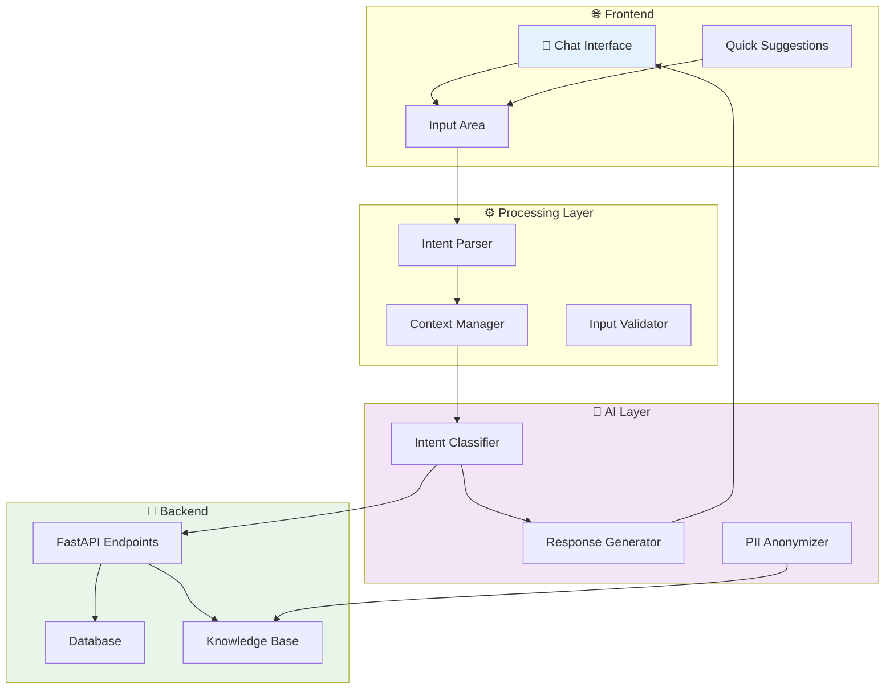
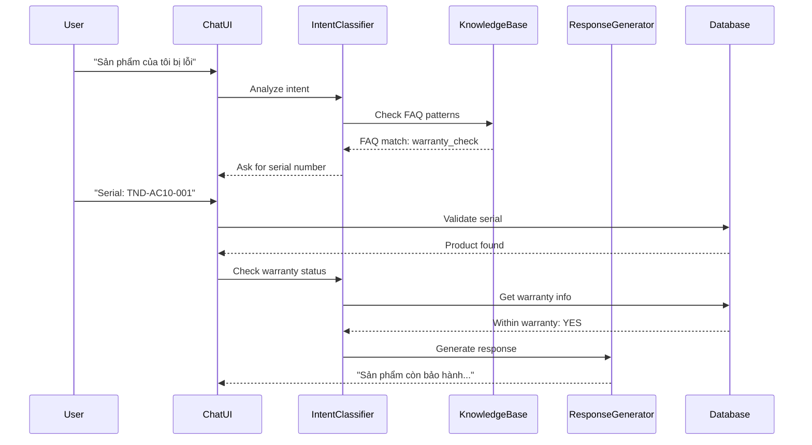

# HỆ THỐNG CHATBOT AI - BẢO HÀNH PRO
## Thiết kế & Đặc tả Kỹ thuật

> **Phiên bản:** v1.0
> **Ngày tạo:** 2026-10-17
> **Trạng thái:** Đang phát triển

---

## MỤC LỤC

1. [Tổng quan](#1-tổng-quan)
2. [Architecture](#2-architecture)
3. [UX/UI Design Principles](#3-uxui-design-principles)
4. [Features](#4-features)
5. [API Specification](#5-api-specification)
6. [Test Cases](#6-test-cases)
7. [Implementation Checklist](#7-implementation-checklist)

---

## 1. TỔNG QUAN

### 1.1 Mục tiêu

Xây dựng Chatbot AI hỗ trợ khách hàng và nhân viên trong việc:
- **Tra cứu thông tin bảo hành** - Kiểm tra trạng thái sản phẩm, serial
- **Tạo yêu cầu bảo hành** - Hướng dẫn từng bước
- **Kiểm tra điều kiện bảo hành** - Tự động xác minh
- **Theo dõi tiến độ** - Cập nhật trạng thái phiếu
- **FAQ tự động** - Trả lời câu hỏi thường gặp

### 1.2 Design Philosophy

```
┌─────────────────────────────────────────────────────────────────────┐
│                    DESIGN PRINCIPLES                                   │
├─────────────────────────────────────────────────────────────────────┤
│                                                                      │
│  1. GUIDED INTAKE - Không phải decision engine                      │
│     Chatbot thu thập thông tin, không tự quyết định                │
│                                                                      │
│  2. HUMAN ESCALATION - Chuyển tiếp khi cần                        │
│     Trường hợp phức tạp → nhân viên với đầy đủ context           │
│                                                                      │
│  3. TRANSPARENT - Không hứa hẹn những gì không chắc chắn          │
│     "Có vẻ như..." thay vì "Chắc chắn là..."                      │
│                                                                      │
│  4. PROGRESSIVE - Thu thập thông tin từng bước                     │
│     Không hỏi tất cả cùng lúc, điều chỉnh theo flow              │
│                                                                      │
│  5. ACCESSIBLE - Hỗ tr� mọi người                                 │
│     Keyboard nav, screen reader, reduced motion                      │
│                                                                      │
└─────────────────────────────────────────────────────────────────────┘
```

---

## 2. ARCHITECTURE

### 2.1 System Architecture



### 2.2 Conversation Flow



---

## 3. UX/UI DESIGN PRINCIPLES

### 3.1 Layout Structure

```
┌─────────────────────────────────────────────────────────────────────────────────┐
│  ┌─────────────────────────────────────────────────────────────────────────┐  │
│  │ 🤖 AI Chat Assistant                                    [─] [□] [×]    │  │
│  │ ────────────────────────────────────────────────────────────────────────────│  │
│  │                                                                          │  │
│  │  ┌──────────────┐                                                        │  │
│  │  │ 🤖 Bot       │                                                        │  │
│  │  │              │                                                        │  │
│  │  │ Xin chào! Tôi │                                                        │  │
│  │  │ có thể giúp  │                                                        │  │
│  │  │ gì cho bạn?  │                                                        │  │
│  │  └──────────────┘                                                        │  │
│  │                                          ┌──────────────┐              │  │
│  │                                          │ 👤 Bạn       │              │  │
│  │                                          │              │              │  │
│  │                                          │ Serial: ... │              │  │
│  │                                          └──────────────┘              │  │
│  │                                                                          │  │
│  │  ┌──────────────────────────────────────────────────────────────────┐   │  │
│  │  │ 💡 Gợi ý nhanh                                                   │   │  │
│  │  │                                                                   │   │  │
│  │  │ [🔍 Tra cứu serial]  [📋 Tạo yêu cầu BH]  [❓ FAQ]              │   │  │
│  │  │                                                                   │   │  │
│  │  └──────────────────────────────────────────────────────────────────┘   │  │
│  │                                                                          │  │
│  ├───────────────────────────────────────────────────────────────────────────│  │
│  │  ┌─────────────────────────────────────────────────────────────────┐   │  │
│  │  │ 💬 Nhập tin nhắn...                                    [Gửi ➤] │   │  │
│  │  └─────────────────────────────────────────────────────────────────┘   │  │
│  │                                                                          │  │
│  │  Model: Gemini 2.0 │ 🟢 Online │ [⚙️ Cài đặt]                          │  │
│  └─────────────────────────────────────────────────────────────────────────┘  │
└─────────────────────────────────────────────────────────────────────────────────┘
```

### 3.2 Animation Specifications

```yaml
# Animation Guidelines (từ nghiên cứu UX)

typing_indicator:
  type: "pulsing_dots"
  duration: 300ms per dot
  color: "#8b5cf6"  # Purple
  
message_appear:
  animation: "slide_in"
  direction: "bottom"
  duration: 200ms
  easing: "ease-out"
  
scroll_behavior:
  follow_bottom: true
  threshold: 48px  # Stop following if user scrolls up >48px
  jump_button: true  # Show "Jump to latest" pill

streaming_text:
  word_level: true
  citation_pills: true
  announce_on_complete: true  # Not every token

reduced_motion:
  respect_prefers_reduced_motion: true
  instant_transitions: true
```

### 3.3 Component Specifications

#### Message Bubble
```
┌────────────────────────────────────────────────────────────┐
│                                                            │
│  USER MESSAGE (Right-aligned, Primary color)             │
│  ┌────────────────────────────────────────────────────┐  │
│  │                                                    │  │
│  │  Nội dung tin nhắn của user...                    │  │
│  │  Thời gian: 10:30 AM                             │  │
│  │                                                    │  │
│  └────────────────────────────────────────────────────┘  │
│                                                            │
│                    BOT MESSAGE (Left-aligned, Glass)      │
│                    ┌────────────────────────────────────┐ │
│                    │ 🤖                                │ │
│                    │                                    │ │
│                    │ Nội dung trả lời của bot...      │ │
│                    │ Có thể chứa:                     │ │
│                    │ • Bullet points                   │ │
│                    │ • Links                           │ │
│                    │ • Code blocks                     │ │
│                    │                                    │ │
│                    │ Thời gian: 10:30 AM               │ │
│                    └────────────────────────────────────┘ │
│                                                            │
└────────────────────────────────────────────────────────────┘
```

#### Quick Suggestions
```
┌────────────────────────────────────────────────────────────┐
│  💡 Gợi ý cho bạn                                        │
│                                                            │
│  ┌─────────────────┐ ┌─────────────────┐ ┌─────────────┐  │
│  │ 🔍 Tra cứu     │ │ 📋 Tạo yêu cầu │ │ ❓ FAQ      │  │
│  │    serial      │ │    bảo hành     │ │   chung     │  │
│  └─────────────────┘ └─────────────────┘ └─────────────┘  │
│                                                            │
│  ┌─────────────────┐ ┌─────────────────┐                   │
│  │ 📦 Kiểm tra    │ │ 💰 Thanh toán  │                   │
│  │    điều kiện   │ │    online       │                   │
│  │    BH          │ │                 │                   │
│  └─────────────────┘ └─────────────────┘                   │
└────────────────────────────────────────────────────────────┘
```

---

## 4. FEATURES

### 4.1 Core Features

| Feature | Description | Priority |
|---------|-------------|----------|
| Real-time chat | Streaming responses | P0 |
| Intent classification | Understand user intent | P0 |
| Serial lookup | Find product by serial | P0 |
| Warranty check | Verify warranty status | P0 |
| Quick actions | Clickable suggestions | P0 |
| Typing indicator | Show AI is thinking | P0 |
| Conversation history | Save context | P1 |
| Escalation | Transfer to human | P1 |
| Multi-language | Vietnamese responses | P2 |

### 4.2 Intent Patterns

```javascript
const INTENT_PATTERNS = {
  // Warranty related
  warranty_check: {
    keywords: ['bh', 'bảo hành', 'hết hạn', 'còn bảo hành', 'warranty', 'check warranty'],
    slots: ['serial_number']
  },
  
  ticket_status: {
    keywords: ['phiếu', 'ticket', 'trạng thái', 'status', 'tiến độ', 'progress'],
    slots: ['ticket_code']
  },
  
  create_ticket: {
    keywords: ['tạo', 'tạo phiếu', 'yêu cầu', 'create', 'request', 'mới'],
    slots: ['serial', 'issue_description']
  },
  
  product_info: {
    keywords: ['sản phẩm', 'product', 'thông tin', 'specs', 'model'],
    slots: ['serial_number']
  },
  
  // FAQ
  faq_shipping: {
    keywords: ['vận chuyển', 'shipping', 'giao hàng', 'delivery'],
  },
  
  faq_repair: {
    keywords: ['sửa', 'repair', 'thay', 'replace', 'linh kiện'],
  },
  
  // Greetings
  greeting: {
    keywords: ['xin chào', 'hello', 'hi', 'chào', 'hey'],
  },
  
  thanks: {
    keywords: ['cảm ơn', 'thank', 'thanks', 'cam on'],
  }
}
```

### 4.3 Response Templates

```javascript
const RESPONSE_TEMPLATES = {
  greeting: {
    text: "Xin chào! 👋 Tôi là trợ lý AI của BảoHành Pro. Tôi có thể giúp bạn:",
    suggestions: [
      { text: "Tra cứu serial", action: "lookup_serial" },
      { text: "Kiểm tra bảo hành", action: "check_warranty" },
      { text: "Tạo yêu cầu bảo hành", action: "create_ticket" },
      { text: "Xem FAQ", action: "show_faq" }
    ]
  },
  
  warranty_yes: {
    text: (product, expiry) => `✅ Sản phẩm **${product.name}** (Serial: ${product.serial}) vẫn còn trong thời hạn bảo hành.
    
📅 **Ngày hết hạn:** ${expiry}
⏰ **Còn lại:** ${daysLeft} ngày

Bạn có muốn tạo yêu cầu bảo hành không?`,
    suggestions: [
      { text: "Tạo yêu cầu BH", action: "create_ticket" },
      { text: "Tra cứu sản phẩm khác", action: "lookup_serial" }
    ]
  },
  
  warranty_no: {
    text: (product, reason) => `❌ Sản phẩm **${product.name}** (Serial: ${product.serial}) đã hết thời hạn bảo hành.

📅 **Ngày hết hạn:** ${expiry}
📋 **Lý do:** ${reason}

**Các tùy chọn cho bạn:**
• Dịch vụ sửa chữa có phí
• Thay linh kiện chính hãng
• Liên hệ hotline để được tư vấn`,
    suggestions: [
      { text: "Báo giá sửa chữa", action: "quote_repair" },
      { text: "Liên hệ hotline", action: "contact" }
    ]
  },
  
  serial_not_found: {
    text: "Không tìm thấy sản phẩm với serial này. Vui lòng kiểm tra lại serial và thử lại.

💡 **Mẹo:** Serial thường in trên nhãn sản phẩm hoặc hộp đựng.",
    suggestions: [
      { text: "Thử lại", action: "lookup_serial" },
      { text: "Đăng ký sản phẩm mới", action: "register_product" }
    ]
  }
}
```

---

## 5. API SPECIFICATION

### 5.1 Chat Endpoint

```
POST /api/v1/ai/chat
Authorization: Bearer {token}

Request:
{
  "message": "Serial TND-AC10-001 của tôi bị lỗi",
  "context": {
    "user_id": 123,
    "session_id": "sess_abc123"
  }
}

Response:
{
  "response": "Tôi đã tìm thấy sản phẩm của bạn...",
  "intent": "warranty_check",
  "confidence": 0.95,
  "suggestions": [
    { "text": "Tạo yêu cầu BH", "action": "create_ticket" }
  ],
  "data": {
    "serial": "TND-AC10-001",
    "product_name": "Router Tenda AC10",
    "warranty_status": "within"
  }
}
```

### 5.2 Streaming Endpoint

```
POST /api/v1/ai/chat/stream
Authorization: Bearer {token}

Request:
{
  "message": "Sản phẩm của tôi bị gì?",
  "context": {...}
}

Response: Server-Sent Events (SSE)
event: intent
data: {"intent": "faq_repair", "confidence": 0.87}

event: token
data: {"token": "Tôi"}

event: token
data: {"token": " có"}

event: token
data: {"token": " thể"}

...

event: done
data: {"full_response": "...", "suggestions": [...]}
```

---

## 6. TEST CASES

### 6.1 Unit Test Cases

```yaml
test_suite: AI_Chatbot_Unit_Tests

test_cases:
  - id: TC001
    category: Intent Classification
    input: "Serial ABC123 của tôi còn bảo hành không?"
    expected_intent: "warranty_check"
    validate_slots: { serial: "ABC123" }
    
  - id: TC002
    category: Intent Classification
    input: "Xin chào bot"
    expected_intent: "greeting"
    
  - id: TC003
    category: Serial Validation
    input: "TND-AC10-001"
    expected_result: "valid_format"
    
  - id: TC004
    category: Serial Validation
    input: "INVALID123"
    expected_result: "not_found"
    
  - id: TC005
    category: Warranty Check
    input:
      serial: "TND-AC10-001"
      manufacture_date: "2024-03-15"
      warranty_months: 12
    expected_result: "within_warranty"
    
  - id: TC006
    category: PII Anonymization
    input: "Email tôi là test@gmail.com"
    expected_output: "Email tôi là [REDACTED_EMAIL]"
    
  - id: TC007
    category: PII Anonymization
    input: "SĐT: 0901234567"
    expected_output: "SĐT: [REDACTED_PHONE]"
```

### 6.2 Integration Test Cases

```yaml
test_suite: AI_Chatbot_Integration_Tests

scenarios:
  - name: "Happy Path - Warranty Check"
    steps:
      - user: "Xin chào"
      - bot: greeting_response
      - user: "Tra cứu serial TND-AC10-001"
      - bot: product_info_response
      - user: "Còn bảo hành không?"
      - bot: warranty_status_response
      - user: "Cảm ơn"
      - bot: closing_response
      
  - name: "Serial Not Found"
    steps:
      - user: "Tra cứu serial ABC999"
      - bot: not_found_response
      - bot: offer_register_product
      
  - name: "Escalation Required"
    steps:
      - user: "Tôi muốn khiếu nại về dịch vụ"
      - bot: escalate_response
      - bot: connect_to_agent
```

### 6.3 User Acceptance Tests

```markdown
## UAT: AI Chatbot - BảoHành Pro

### Pre-conditions
- User đã đăng nhập
- Backend đang chạy
- AI service online

### Test Scenarios

#### TC-UAT-001: Giao diện chat
**Steps:**
1. Mở trang AI Console
2. Kiểm tra layout chat
3. Kiểm tra suggestions

**Expected:**
- [ ] Header với icon AI
- [ ] Message area có thể scroll
- [ ] Input field ở dưới
- [ ] 4-6 quick suggestions hiển thị

#### TC-UAT-002: Gửi tin nhắn
**Steps:**
1. Gõ "Xin chào"
2. Bấm Send
3. Quan sát response

**Expected:**
- [ ] User message hiển thị bên phải
- [ ] Bot typing indicator xuất hiện
- [ ] Bot response hiển thị bên trái
- [ ] Suggestions mới xuất hiện

#### TC-UAT-003: Tra cứu serial hợp lệ
**Steps:**
1. Gõ "Tra cứu serial TND-AC10-001"
2. Xem response

**Expected:**
- [ ] Bot xác nhận serial
- [ ] Hiển thị thông tin sản phẩm
- [ ] Hiển thị trạng thái bảo hành

#### TC-UAT-004: Serial không tồn tại
**Steps:**
1. Gõ "Tra cứu serial XXX999"
2. Xem response

**Expected:**
- [ ] Thông báo serial không tồn tại
- [ ] Đề xuất đăng ký sản phẩm mới

#### TC-UAT-005: Animation mượt
**Steps:**
1. Quan sát message appear
2. Scroll lên rồi scroll xuống
3. Kiểm tra reduced motion

**Expected:**
- [ ] Message slide in mượt (200ms)
- [ ] Typing indicator pulsing
- [ ] Jump to latest button xuất hiện khi scroll up
- [ ] Instant transition nếu reduced motion
```

---

## 7. IMPLEMENTATION CHECKLIST

### Phase 1: Core Chat UI
- [ ] Create ChatBubble component
- [ ] Create ChatInput component
- [ ] Create Suggestions component
- [ ] Create typing indicator
- [ ] Implement smooth scroll behavior
- [ ] Add reduced motion support

### Phase 2: Backend Integration
- [ ] Create /api/v1/ai/chat endpoint
- [ ] Implement intent classification
- [ ] Add PII anonymization
- [ ] Create response templates
- [ ] Add streaming support

### Phase 3: Advanced Features
- [ ] Conversation history
- [ ] Quick actions (clickable suggestions)
- [ ] Context persistence
- [ ] Escalation flow

### Phase 4: Polish
- [ ] Accessibility audit
- [ ] Performance optimization
- [ ] Error handling
- [ ] Loading states

---

## APPENDIX

### A. Sample Conversation Flows

```
Flow 1: Warranty Check
─────────────────────────────────────────────────────────────

👤 User: Xin chào
🤖 Bot: Xin chào! 👋 Tôi là trợ lý AI của BảoHành Pro...
    [Quick suggestions]

👤 User: [Clicks "Tra cứu serial"]
🤖 Bot: Vui lòng nhập serial sản phẩm...
    [Input field focused]

👤 User: TND-AC10-001
🤖 Bot: 🔍 Đang tra cứu...
    [Typing indicator]

🤖 Bot: ✅ Tìm thấy sản phẩm!
    Product: Router Tenda AC10
    Serial: TND-AC10-001
    Status: ✅ Còn bảo hành
    Expiry: 15/03/2025
    
    [Actions: Tạo yêu cầu BH | Tra cứu khác]

👤 User: Tạo yêu cầu bảo hành
🤖 Bot: Tôi sẽ hỗ trợ bạn tạo yêu cầu...
    Step 1: Mô tả lỗi sản phẩm
    [Text input]

─────────────────────────────────────────────────────────────

Flow 2: Issue Resolution
─────────────────────────────────────────────────────────────

👤 User: Router không bật được
🤖 Bot: 🔍 Tôi hiểu rồi. Để kiểm tra...
    [Typing...]

🤖 Bot: Đã tìm thấy sản phẩm của bạn.
    Router Tenda AC10 - Còn bảo hành ✅
    
    Để tạo yêu cầu bảo hành, vui lòng mô tả:
    1. Lỗi cụ thể: "Không bật được, đèn power không sáng"
    2. Thời điểm xuất hiện
    3. Đã thử khắc phục gì chưa?

👤 User: Mới mua 1 tuần, chưa thử gì
🤖 Bot: ✅ Đã ghi nhận. Để tôi kiểm tra...


🤖 Bot: 📋 **Yêu cầu bảo hành đã được tạo!**
    Mã phiếu: WR-2026-0900
    Trạng thái: RECEIVED
    Ngày tạo: 17/10/2026
    
    Kỹ thuật viên sẽ liên hệ trong 24h.
    
    [View ticket | Back to home]
```

---

**Document Version:** v1.0
**Last Updated:** 2026-10-17
