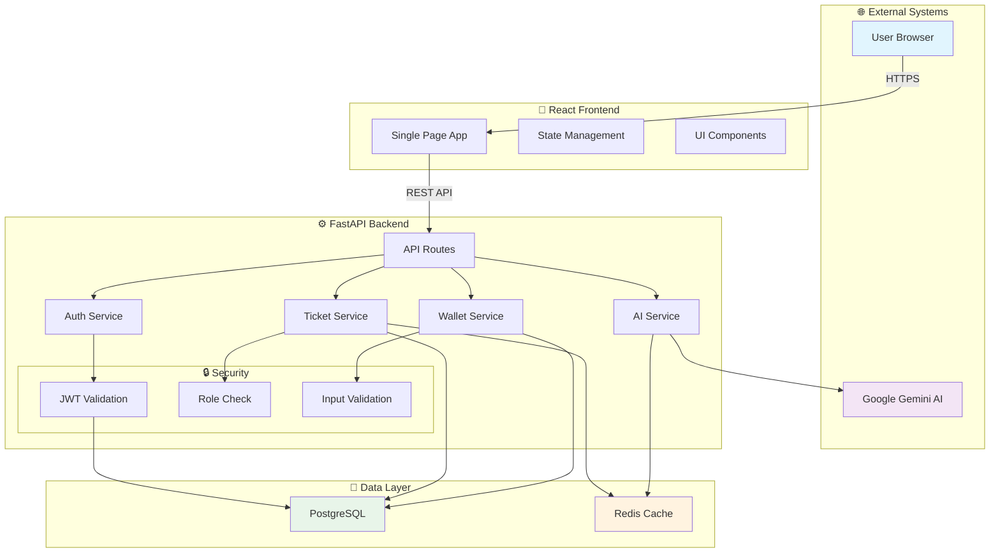
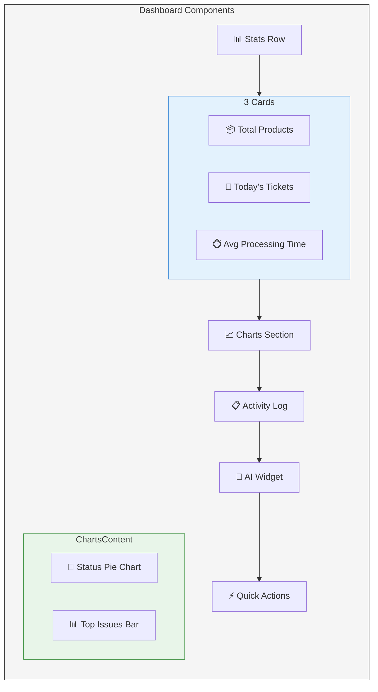
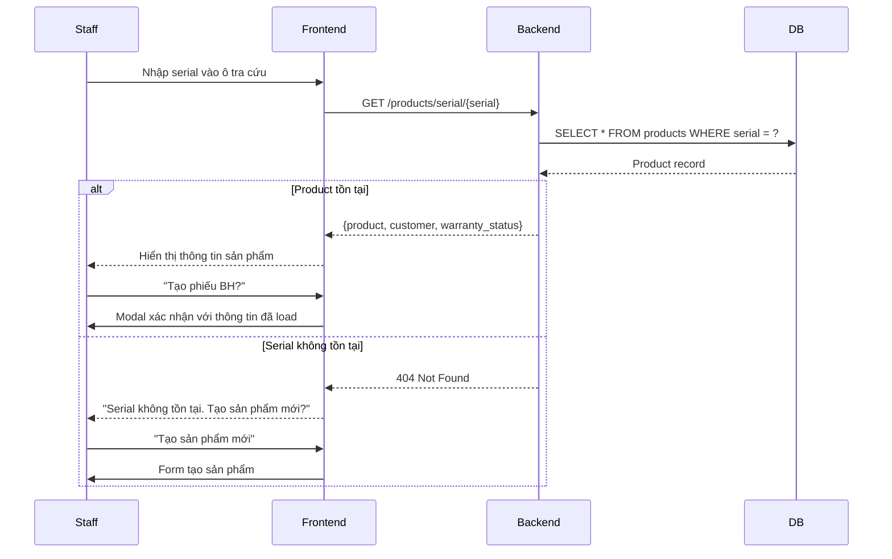
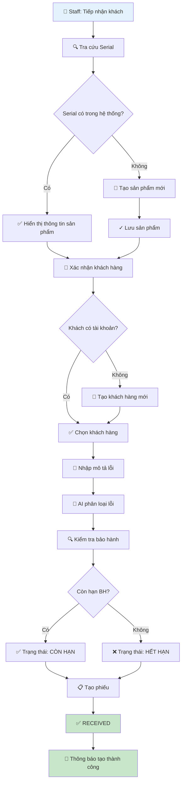
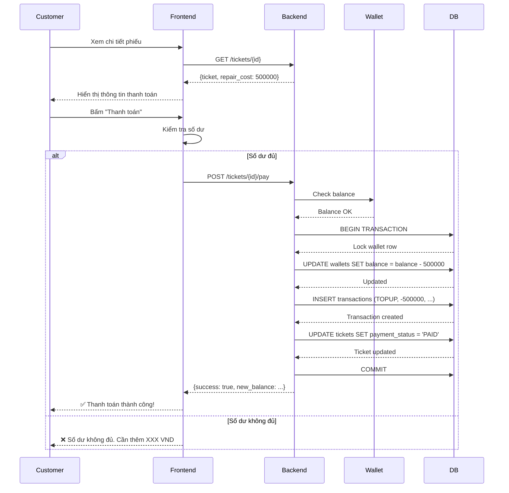
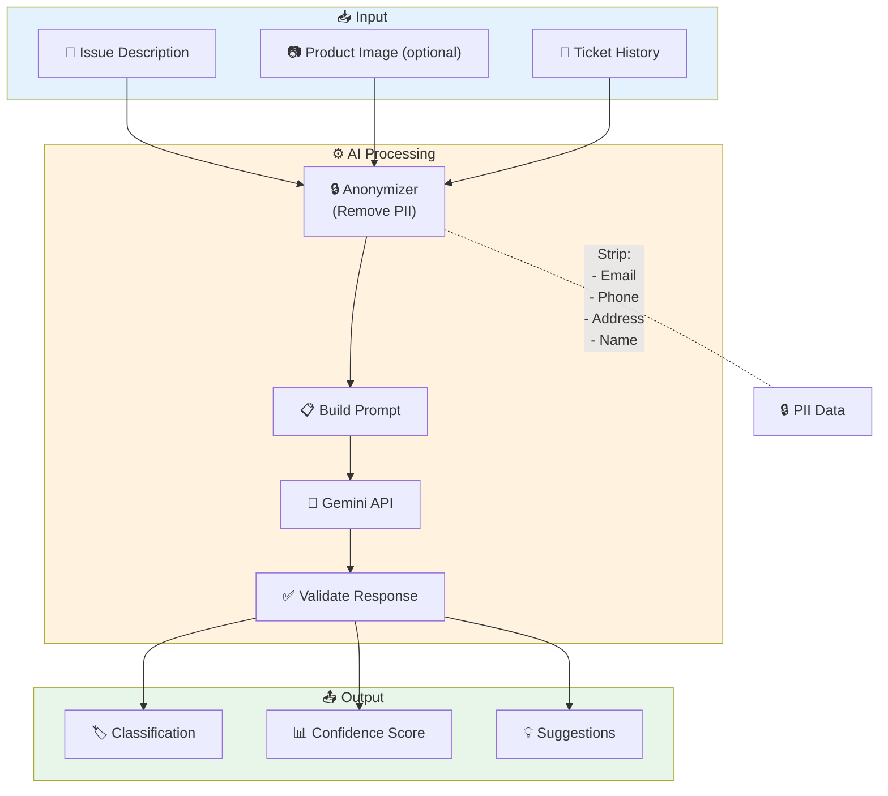
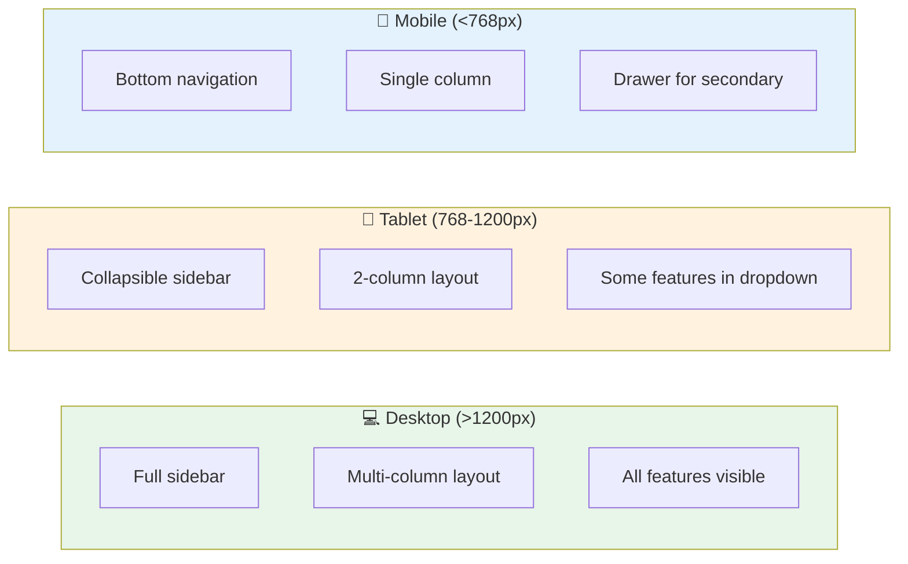

# HÌNH ẢNH DEMO & MOCKUP
# HỆ THỐNG QUẢN LÝ BẢO HÀNH TÍCH HỢP AI

> **Phiên bản:** v1.0
> **Ngày tạo:** 2026-10-17

---

## MỤC LỤC

1. [Sơ đồ kiến trúc tổng quan](#1-sơ-đồ-kiến-trúc-tổng-quan)
2. [Dashboard & Trang chủ](#2-dashboard--trang-chủ)
3. [Quản lý sản phẩm](#3-quản-lý-sản-phẩm)
4. [Quản lý phiếu bảo hành](#4-quản-lý-phiếu-bảo-hành)
5. [Workflow trạng thái](#5-workflow-trạng-thái)
6. [Ví & Thanh toán](#6-ví--thanh-toán)
7. [AI Console](#7-ai-console)
8. [Sổ tài chính](#8-sổ-tài-chính)
9. [Wireframes Mobile](#9-wireframes-mobile)

---

## 1. SƠ ĐỒ KIẾN TRÚC TỔNG QUAN

### 1.1 High-Level Architecture

```
┌─────────────────────────────────────────────────────────────────────────────┐
│                              USERS                                          │
│  ┌──────────┐  ┌──────────┐  ┌──────────┐  ┌──────────┐                    │
│  │ Customer │  │  Staff  │  │ Technician│  │  Admin  │                    │
│  └────┬─────┘  └────┬─────┘  └────┬─────┘  └────┬─────┘                    │
└───────┼─────────────┼─────────────┼─────────────┼──────────────────────────┘
        │             │             │             │
        ▼             ▼             ▼             ▼
┌─────────────────────────────────────────────────────────────────────────────┐
│                         FRONTEND (React SPA)                                │
│  ┌─────────────────────────────────────────────────────────────────────┐  │
│  │                                                                     │  │
│  │   ┌─────────┐  ┌─────────┐  ┌─────────┐  ┌─────────┐  ┌─────────┐  │  │
│  │   │Dashboard│  │Products │  │Tickets │  │ Wallet  │  │Settings │  │  │
│  │   └─────────┘  └─────────┘  └─────────┘  └─────────┘  └─────────┘  │  │
│  │                                                                     │  │
│  └─────────────────────────────────────────────────────────────────────┘  │
└─────────────────────────────────────────────────────────────────────────────┘
                                    │
                                    │ REST API (JWT Auth)
                                    ▼
┌─────────────────────────────────────────────────────────────────────────────┐
│                          BACKEND (FastAPI)                                 │
│                                                                             │
│   ┌─────────────┐   ┌─────────────┐   ┌─────────────┐   ┌─────────────┐   │
│   │ Auth APIs   │   │ Product APIs│   │ Ticket APIs │   │ Wallet APIs│   │
│   └─────────────┘   └─────────────┘   └─────────────┘   └─────────────┘   │
│                                                                             │
│   ┌─────────────┐   ┌─────────────┐   ┌─────────────┐                     │
│   │ AI Services │   │Finance APIs │   │  Notif APIs │                     │
│   └─────────────┘   └─────────────┘   └─────────────┘                     │
│                                                                             │
│   ┌─────────────────────────────────────────────────────────────────┐     │
│   │                    Security Layer                                  │     │
│   │   JWT Validation │ RBAC │ Input Validation │ Rate Limiting        │     │
│   └─────────────────────────────────────────────────────────────────┘     │
│                                                                             │
└─────────────────────────────────────────────────────────────────────────────┘
                                    │
                    ┌───────────────┼───────────────┐
                    ▼               ▼               ▼
            ┌──────────────┐ ┌──────────────┐ ┌──────────────┐
            │  PostgreSQL  │ │  Gemini AI   │ │  File Storage │
            │  (Primary)   │ │   (Cloud)    │ │   (Uploads)   │
            └──────────────┘ └──────────────┘ └──────────────┘
```

### 1.2 Data Flow Diagram



### 1.3 Entity Relationship Diagram

```mermaid
erDiagram
    USERS {
        int id PK
        string email UK
        string full_name
        string phone
        string hashed_password
        string role
        boolean is_active
        datetime created_at
    }

    PRODUCTS {
        int id PK
        string name
        string serial_number UK
        string category
        int warranty_months
        date manufacture_date
        int customer_id FK
        decimal price
        text description
    }

    WARRANTY_TICKETS {
        int id PK
        string ticket_code UK
        int product_id FK
        int customer_id FK
        int technician_id FK
        text issue_description
        string status
        string ai_classification
        text ai_summary
        decimal repair_cost
        string payment_status
        datetime created_at
    }

    WARRANTY_HISTORY {
        int id PK
        int ticket_id FK
        int technician_id FK
        text action_note
        string status_from
        string status_to
        datetime created_at
    }

    WALLETS {
        int id PK
        int user_id FK UK
        decimal balance
    }

    TRANSACTIONS {
        int id PK
        int wallet_id FK
        string type
        decimal amount
        decimal balance_after
        string reference
        string created_at
    }

    FINANCE_TRANSACTIONS {
        int id PK
        string txn_code UK
        string date
        string description
        decimal amount
        string type
        string category
        string created_at
    }

    USERS ||--o{ PRODUCTS : owns
    USERS ||--o{ WARRANTY_TICKETS : creates
    USERS ||--o{ WARRANTY_TICKETS : assigned_to
    USERS ||--|| WALLETS : has
    PRODUCTS ||--o{ WARRANTY_TICKETS : generates
    WARRANTY_TICKETS ||--o{ WARRANTY_HISTORY : has
    WALLETS ||--o{ TRANSACTIONS : contains
    WARRANTY_TICKETS ||--o| TRANSACTIONS : paid_by
```

---

## 2. DASHBOARD & TRANG CHỦ

### 2.1 Dashboard Overview Mockup

```
┌─────────────────────────────────────────────────────────────────────────────────┐
│  ┌─────────────────────────────────────────────────────────────────────────┐  │
│  │  🏠 BảoHành Pro                    🔔 3  │ 👤 Admin ▼  │ ⚙️ │  🌐 │     │  │
│  └─────────────────────────────────────────────────────────────────────────┘  │
├─────────────────────────────────────────────────────────────────────────────────┤
│ ┌───────────┐                                                                     │
│ │ Dashboard │                                                                     │
│ │ ──────────│                                                                     │
│ │ 📊 Tổng quan│    ┌──────────────────────────────────────────────────────────┐ │
│ │ 📦 Sản phẩm│    │                BIỂU ĐỒ TRẠNG THÁI PHIẾU                   │ │
│ │ 🎫 Phiếu BH │    │                                                          │ │
│ │ 👥 Khách hàng│   │   RECEIVED ████████████ 45%                             │ │
│ │ 👨‍🔧 Kỹ thuật │   │   INSPECTION ██████ 25%                              │ │
│ │ 💰 Tài chính │   │   REPAIRING ████ 18%                                   │ │
│ │ 💳 Ví tiền  │    │   COMPLETED ███ 12%                                    │ │
│ │ 🤖 AI Console│   │                                                          │ │
│ │ 📈 Thống kê │    │   [====================] Total: 156 phiếu              │ │
│ │ ⚙️ Cài đặt │    └──────────────────────────────────────────────────────────┘ │
│ └───────────┘                                                                     │
│                                                                                   │
│ ┌────────────────────────────┐  ┌────────────────────────────┐  ┌──────────────┐│
│ │ 📦 TỔNG SẢN PHẨM          │  │ 🎫 PHIẾU HÔM NAY         │  │ ⏱️ TTB XỬ LÝ││
│ │                            │  │                            │  │              ││
│ │     1,234                  │  │      28                    │  │   4.5 giờ    ││
│ │                            │  │                            │  │              ││
│ │  ↑ 12% so với tuần trước  │  │  ↑ 5% so với hôm qua      │  │  ↓ 10% nhanh hơn│
│ └────────────────────────────┘  └────────────────────────────┘  └──────────────┘│
│                                                                                   │
│ ┌─────────────────────────────────────────────────────────────────────────────┐ │
│ │ 🏆 TOP 5 LỖI NHIỀU NHẤT (AI Classification)                                │ │
│ │                                                                          │ │
│ │ 1. 🔌 HARDWARE - Cổng USB hỏng         ████████████████████  42%          │ │
│ │ 2. 💻 SOFTWARE - Firmware lỗi          ████████████████      35%          │ │
│ │ 3. ⚡ POWER - Adapter hỏng           ████████              15%          │ │
│ │ 4. 📶 NETWORK - Không kết nối        ██████                6%           │ │
│ │ 5. 🔧 PHYSICAL - Vỏ hỏng            ████                  2%           │ │
│ └─────────────────────────────────────────────────────────────────────────────┘ │
│                                                                                   │
│ ┌─────────────────────────────────────────────────────────────────────────────┐ │
│ │ 📋 HOẠT ĐỘNG GẦN ĐÂY                                                        │ │
│ │                                                                          │ │
│ │ 🟢 10:30  Phiếu WR-2026-0892 đã chuyển sang COMPLETED                    │ │
│ │ 🟡 10:15  Phiếu WR-2026-0891 được phân công cho Nguyễn Văn A             │ │
│ │ 🔵 09:45  Tạo phiếu mới WR-2026-0890 - Khách hàng: Trần Thị B          │ │
│ │ 🔵 09:30  Sản phẩm mới được đăng ký: Router Tenda AC10                  │ │
│ │ 🟢 09:00  Phiếu WR-2026-0889 đã chuyển sang COMPLETED                   │ │
│ └─────────────────────────────────────────────────────────────────────────────┘ │
│                                                                                   │
│ ┌─────────────────────────────────────────────────────────────────────────────┐ │
│ │ 🤖 AI WIDGET                                                                  │ │
│ │                                                                          │ │
│ │  Model: Gemini 2.0 Flash    │  Status: 🟢 Online   │  Requests: 1,234/day   │ │
│ │                                                                          │ │
│ │  [Bật AI tự động]  [Xem chi tiết]                                       │ │
│ └─────────────────────────────────────────────────────────────────────────────┘ │
│                                                                                   │
│ ┌─────────────────────────────────────────────────────────────────────────────┐ │
│ │ ⚡ THAO TÁC NHANH                                                          │ │
│ │                                                                          │ │
│ │  [+ Tạo phiếu mới]  [+ Thêm sản phẩm]  [+ Thêm khách hàng]              │ │
│ └─────────────────────────────────────────────────────────────────────────────┘ │
└─────────────────────────────────────────────────────────────────────────────────┘
```

### 2.2 Dashboard Components



---

## 3. QUẢN LÝ SẢN PHẨM

### 3.1 Products Page Mockup

```
┌─────────────────────────────────────────────────────────────────────────────────┐
│  🏠 BảoHành Pro          🔔  │ 👤 Admin ▼  │                                        │
├─────────────────────────────────────────────────────────────────────────────────┤
│ ┌───────────┐  ┌──────────────────────────────────────────────────────────────┐ │
│ │ Dashboard │  │  📦 QUẢN LÝ SẢN PHẨM                                        │ │
│ │ ──────────│  │                                                              │ │
│ │ 📊 Tổng quan│  │  ┌──────────────────────────────────────────────────────┐ │ │
│ │ 📦 Sản phẩm│◀─│  │ 🔍 Tìm kiếm serial, tên...           [+ Thêm sản phẩm]│ │ │
│ │ 🎫 Phiếu BH │  │  └──────────────────────────────────────────────────────┘ │ │
│ │ 👥 Khách hàng│  │                                                              │ │
│ │ 👨‍🔧 Kỹ thuật │  │  ┌──────────────────────────────────────────────────────────┐│ │
│ │ 💰 Tài chính │  │  │ ☑ │ Tên SP        │ Serial      │ Danh mục │ BH   │ Giá ││ │
│ │ 💳 Ví tiền  │  │  │─────┼──────────────┼─────────────┼───────────┼───────┼────││ │
│ │ 🤖 AI Console│  │  │ ☑ │Router Tenda   │ TND-AC10-001│ Router    │ 12 tháng│1.2M││ │
│ │ 📈 Thống kê │  │  │ ☐ │Camera IP      │ CAM-HI3519-002│ Camera  │ 24 tháng│2.5M││ │
│ │ ⚙️ Cài đặt │  │  │ ☑ │Switch D-Link  │ SW-DLK-003  │ Switch    │ 12 tháng│890K││ │
│ └───────────┘  │  │ ☐ │Adapter TP-Link │ ADP-TPL-004 │ Adapter   │ 6 tháng │250K││ │
│                │  │ ☑ │Router Xiaomi   │ RTR-XMI-005 │ Router    │ 12 tháng│1.8M││ │
│                │  │ ... (50 sản phẩm)                                          ││ │
│                │  └──────────────────────────────────────────────────────────┘│ │
│                │                                                              │ │
│                │  < Trang 1/5 >  [Hiển thị 10/số trang ▼]                    │ │
│                └──────────────────────────────────────────────────────────────┘ │
└─────────────────────────────────────────────────────────────────────────────────┘
```

### 3.2 Product Detail Modal

```
┌─────────────────────────────────────────────────────────────────────────────────┐
│  📦 CHI TIẾT SẢN PHẨM                                           [✕ Đóng]       │
├─────────────────────────────────────────────────────────────────────────────────┤
│                                                                                  │
│  ┌─────────────────────────────────────────────────────────────────────────┐     │
│  │  📷        │  Tên: Router WiFi Tenda AC10                              │     │
│  │  ┌─────┐  │  SKU: RT-AC10-001                                         │     │
│  │  │ IMG │  │  Serial: TND-AC10-001                                      │     │
│  │  │     │  │  Danh mục: Router                                          │     │
│  │  └─────┘  │  Giá: 1,200,000 VND                                        │     │
│  │  [Đổi ảnh] │                                                         │     │
│  └─────────────────────────────────────────────────────────────────────────┘     │
│                                                                                  │
│  📅 Thông tin bảo hành                                                          │
│  ─────────────────────────────────────────────────────────────────────────────── │
│  │  Ngày sản xuất:    │  15/03/2024                                         │     │
│  │  Thời hạn BH:      │  12 tháng                                           │     │
│  │  Ngày hết hạn:     │  15/03/2025                                         │     │
│  │  Tình trạng BH:    │  ✅ Còn hạn (còn 150 ngày)                          │     │
│                                                                                  │
│  👤 Thông tin khách hàng                                                         │
│  ─────────────────────────────────────────────────────────────────────────────── │
│  │  Tên:             │  Nguyễn Văn Minh                                     │     │
│  │  Email:           │  minh.nguyen@email.com                               │     │
│  │  Điện thoại:      │  0901234567                                          │     │
│  │  Địa chỉ:         │  123 Đường ABC, Quận 1, TP.HCM                      │     │
│                                                                                  │
│  📝 Mô tả sản phẩm                                                             │
│  ─────────────────────────────────────────────────────────────────────────────── │
│  │  Router WiFi Dual Band AC10, tốc độ 1167Mbps, 4 antenne 5dBi              │     │
│  │  Hỗ trợ MU-MIMO, phù hợp cho nhà 3-4 tầng                               │     │
│  └─────────────────────────────────────────────────────────────────────────┘     │
│                                                                                  │
│  📜 LỊCH SỬ BẢO HÀNH                                                           │
│  ─────────────────────────────────────────────────────────────────────────────── │
│  │  📅 20/06/2024  │  Phiếu WR-2026-0089                                   │     │
│  │  📝 Lỗi: Mất kết nối WiFi sau 30 phút                                 │     │
│  │  📊 Trạng thái: ✅ COMPLETED                                            │     │
│  └─────────────────────────────────────────────────────────────────────────┘     │
│                                                                                  │
│                     [✏️ Chỉnh sửa]    [🗑️ Xóa]    [📋 Tạo phiếu BH]            │
└─────────────────────────────────────────────────────────────────────────────────┘
```

### 3.3 Serial Lookup Flow



---

## 4. QUẢN LÝ PHIẾU BẢO HÀNH

### 4.1 Tickets List Page

```
┌─────────────────────────────────────────────────────────────────────────────────┐
│  🏠 BảoHành Pro          🔔  │ 👤 Admin ▼  │                                        │
├─────────────────────────────────────────────────────────────────────────────────┤
│ ┌───────────┐  ┌──────────────────────────────────────────────────────────────┐ │
│ │ Dashboard │  │  🎫 QUẢN LÝ PHIẾU BẢO HÀNH                                  │ │
│ │ ──────────│  │                                                              │ │
│ │ 📊 Tổng quan│  │  ┌──────────────────────────────────────────────────────┐ │ │
│ │ 📦 Sản phẩm│  │  │ 🔍 Tìm mã phiếu, khách hàng...  [+ Tạo phiếu mới]    │ │ │
│ │ 🎫 Phiếu BH │◀─│  │                                                      │ │ │
│ │ 👥 Khách hàng│  │  │ Bộ lọc:  [Tất cả trạng thái ▼] [Tất cả ▼] [Ngày ▼]│ │ │
│ │ 👨‍🔧 Kỹ thuật │  │  └──────────────────────────────────────────────────────┘ │ │
│ │ 💰 Tài chính │  │                                                              │ │
│ │ 💳 Ví tiền  │  │  ┌──────────────────────────────────────────────────────────┐│ │
│ │ 🤖 AI Console│  │  │ Mã      │ Khách hàng   │ Sản phẩm   │ TT  │ Ngày    ││ │
│ │ 📈 Thống kê │  │  │─────────┼──────────────┼─────────────┼─────┼─────────││ │
│ │ ⚙️ Cài đặt │  │  │WR-2026-0892│Trần Thị B │Router Tenda│ 🟢  │20/10/26││ │
│ └───────────┘  │  │WR-2026-0891│Lê Văn C    │Camera IP    │ 🟡  │20/10/26││ │
│                │  │WR-2026-0890│Nguyễn Văn M │Switch D-Link│ 🔵  │20/10/26││ │
│                │  │WR-2026-0889│Phạm Thị D   │Adapter      │ 🟢  │19/10/26││ │
│                │  │WR-2026-0888│Hoàng Văn E  │Router Xiaomi│ 🔴  │19/10/26││ │
│                │  │...                                                         ││ │
│                │  └──────────────────────────────────────────────────────────┘│ │
│                │                                                              │ │
│                │  Trạng thái:  🟢 COMPLETED  🟡 INSPECTION  🔵 RECEIVED  🔴 REJECTED│ │
│                │                                                              │ │
│                │  < Trang 1/8 >  [Hiển thị 20/số trang ▼]                   │ │
│                └──────────────────────────────────────────────────────────────┘ │
└─────────────────────────────────────────────────────────────────────────────────┘
```

### 4.2 Ticket Detail Page

```
┌─────────────────────────────────────────────────────────────────────────────────┐
│  ← Quay lại danh sách                                                           │
├─────────────────────────────────────────────────────────────────────────────────┤
│                                                                                  │
│  ┌─────────────────────────────────────────────────────────────────────────┐     │
│  │  🎫 PHIẾU WR-2026-0892                                    [In phiếu]    │     │
│  │  ═══════════════════════════════════════════════════════════════════════│     │
│  │                                                                         │     │
│  │  Trạng thái:  ┌─────────────────────────────────────────┐               │     │
│  │               │ 🟢 ✅ HOÀN THÀÀNH                       │               │     │
│  │               └─────────────────────────────────────────┘               │     │
│  │                                                                         │     │
│  │  ┌───────────────┐  ┌───────────────┐  ┌───────────────┐              │     │
│  │  │ 📅 Ngày tạo  │  │ 👤 Khách hàng │  │ 👨‍🔧 Kỹ thuật │              │     │
│  │  │ 20/10/2026   │  │ Trần Thị B    │  │ Nguyễn Văn A  │              │     │
│  │  │ 10:30 AM     │  │ 0901234567    │  │ KTV-001       │              │     │
│  │  └───────────────┘  └───────────────┘  └───────────────┘              │     │
│  │                                                                         │     │
│  └─────────────────────────────────────────────────────────────────────────┘     │
│                                                                                  │
│  ┌──────────────────────────────┐  ┌──────────────────────────────────────┐     │
│  │ 📦 THÔNG TIN SẢN PHẨM        │  │ 🔍 KIỂM TRA BẢO HÀNH                  │     │
│  │                              │  │                                      │     │
│  │ Tên: Router Tenda AC10      │  │ Trạng thái: ✅ CÒN HẠN BẢO HÀNH     │     │
│  │ Serial: TND-AC10-001         │  │ Còn lại: 150 ngày                   │     │
│  │ Danh mục: Router            │  │ Lý do: Sản xuất 15/03/2024          │     │
│  │ Giá: 1,200,000 VND         │  │ BH: 12 tháng, hết hạn 15/03/2025    │     │
│  └──────────────────────────────┘  └──────────────────────────────────────┘     │
│                                                                                  │
│  ┌─────────────────────────────────────────────────────────────────────────┐     │
│  │ 🤖 AI CLASSIFICATION                                                    │     │
│  │ ═══════════════════════════════════════════════════════════════════════│     │
│  │                                                                         │     │
│  │  Phân loại:  🔌 HARDWARE                                               │     │
│  │  Độ tin cậy:  95%                                                     │     │
│  │  Mô tả:     Lỗi phần cứng - Cổng USB không nhận thiết bị              │     │
│  │                                                                         │     │
│  │  [Tái phân loại]  [Xem chi tiết AI]                                   │     │
│  └─────────────────────────────────────────────────────────────────────────┘     │
│                                                                                  │
│  ┌─────────────────────────────────────────────────────────────────────────┐     │
│  │ 📝 MÔ TẢ LỖI                                                           │     │
│  │ ═══════════════════════════════════════════════════════════════════════│     │
│  │                                                                         │     │
│  │  Khách hàng phản ánh: "Router không nhận USB, đã thử ổ cứng di động   │     │
│  │  và điện thoại nhưng đều không kết nối được. Đèn USB nhấp nháy        │     │
│  │  nhưng không mount."                                                    │     │
│  │                                                                         │     │
│  │  ─────────────────────────────────────────────────────────────────────  │     │
│  │  📝 Ghi chú sửa chữa (Kỹ thuật viên):                                 │     │
│  │  "Đã thay cổng USB hỏng. Test OK với ổ cứng di động và điện thoại.  │     │
│  │  Firmware đã cập nhật lên bản mới nhất."                              │     │
│  │                                                                         │     │
│  └─────────────────────────────────────────────────────────────────────────┘     │
│                                                                                  │
│  ┌─────────────────────────────────────────────────────────────────────────┐     │
│  │ 💰 CHI PHÍ VÀ THANH TOÁN                                               │     │
│  │ ═══════════════════════════════════════════════════════════════════════│     │
│  │                                                                         │     │
│  │  Chi phí sửa chữa:    350,000 VND                                     │     │
│  │  Phí thay linh kiện:  150,000 VND                                     │     │
│  │  ─────────────────────────────────────────────────────────────────     │     │
│  │  Tổng cộng:         500,000 VND                                       │     │
│  │                                                                         │     │
│  │  Trạng thái thanh toán: ✅ ĐÃ THANH TOÁN (20/10/2026)                 │     │
│  └─────────────────────────────────────────────────────────────────────────┘     │
│                                                                                  │
│  ┌─────────────────────────────────────────────────────────────────────────┐     │
│  │ 📜 LỊCH SỬ XỬ LÝ                                                     │     │
│  │ ═══════════════════════════════════════════════════════════════════════│     │
│  │                                                                         │     │
│  │  🕐 Timeline    │  📋 Hoạt động                                         │     │
│  │  ──────────────┼────────────────────────────────────────────────────  │     │
│  │  20/10 10:30  │  📝 Tạo phiếu mới - RECEIVED                         │     │
│  │  20/10 11:00  │  👨‍🔧 Phân công cho Nguyễn Văn A - INSPECTION        │     │
│  │  20/10 14:00  │  🔍 Kết quả kiểm tra: Cần thay cổng USB - REPAIRING  │     │
│  │  21/10 09:00  │  🔧 Hoàn thành sửa chữa - COMPLETED                   │     │
│  │  21/10 09:30  │  💳 Thanh toán qua ví - PAID                          │     │
│  │  21/10 09:35  │  📧 Gửi thông báo cho khách hàng                      │     │
│  │                                                                         │     │
│  └─────────────────────────────────────────────────────────────────────────┘     │
│                                                                                  │
│        [📤 Tải đính kèm]  [📋 Tạo phiếu mới]  [✏️ Cập nhật trạng thái]       │
│                                                                                  │
└─────────────────────────────────────────────────────────────────────────────────┘
```

---

## 5. WORKFLOW TRẠNG THÁI

### 5.1 Status Workflow Diagram

```mermaid
stateDiagram-v2
    [*] --> RECEIVED
    RECEIVED --> INSPECTION: Phân công kỹ thuật viên
    RECEIVED --> REJECTED: Không đủ điều kiện BH
    
    INSPECTION --> REPAIRING: Xác nhận cần sửa
    INSPECTION --> REJECTED: Không đủ điều kiện
    
    REPAIRING --> COMPLETED: Hoàn thành sửa chữa
    REPAIRING --> REJECTED: Không thể sửa
    
    COMPLETED --> [*]
    REJECTED --> [*]
    
    note right of RECEIVED
        Tiếp nhận sản phẩm
        Kiểm tra serial
        Tạo phiếu
        AI phân loại lỗi
        Kiểm tra BH tự động
    end
    
    note right of INSPECTION
        Kỹ thuật viên kiểm tra
        Chẩn đoán lỗi
        Báo giá (nếu có)
    end
    
    note right of REPAIRING
        Tiến hành sửa chữa
        Thay linh kiện
        Test sau sửa
    end
    
    note right of COMPLETED
        Trả sản phẩm
        Thanh toán
        Gửi thông báo
    end
    
    note right of REJECTED
        Thông báo khách hàng
        Giải thích lý do
        Bàn giao sản phẩm
    end
```

### 5.2 Create Ticket Flow



---

## 6. VÍ & THANH TOÁN

### 6.1 Wallet Page Mockup

```
┌─────────────────────────────────────────────────────────────────────────────────┐
│  🏠 BảoHành Pro          🔔  │ 👤 Minh Nguyen ▼  │                               │
├─────────────────────────────────────────────────────────────────────────────────┤
│ ┌───────────┐  ┌──────────────────────────────────────────────────────────────┐ │
│ │ Dashboard │  │  💳 VÍ CỦA TÔI                                              │ │
│ │ ──────────│  │                                                              │ │
│ │ 📊 Tổng quan│  │  ┌─────────────────────────────────────────────────────┐  │ │
│ │ 📦 Sản phẩm│  │  │                                                      │  │ │
│ │ 🎫 Phiếu BH │  │  │  ┌─────────────────────────────────────────────┐    │  │ │
│ │ 👥 Khách hàng│  │  │  │                                             │    │  │ │
│ │ 👨‍🔧 Kỹ thuật │  │  │  │     💰 SỐ DƯ KHẢ DỤNG                    │    │  │ │
│ │ 💰 Tài chính │  │  │  │                                             │    │  │ │
│ │ 💳 Ví tiền  │◀─│  │  │         5,250,000 VND                       │    │  │ │
│ │ 🤖 AI Console│  │  │  │                                             │    │  │ │
│ │ 📈 Thống kê │  │  │  │    ↑ 500,000 VND (hôm nay)                  │    │  │ │
│ │ ⚙️ Cài đặt │  │  │  └─────────────────────────────────────────────┘    │  │ │
│ └───────────┘  │  │                                                      │  │ │
│                │  │  [+ Nạp tiền]  [📜 Lịch sử giao dịch]               │  │ │
│                │  └─────────────────────────────────────────────────────┘  │ │
│                │                                                              │ │
│                │  ┌──────────────────────────────────────────────────────────┐│ │
│                │  │ 📜 LỊCH SỬ GIAO DỊCH GẦN ĐÂY                           ││ │
│                │  │                                                          ││ │
│                │  │  📅 Hôm nay                                              ││ │
│                │  │  ┌────────────────────────────────────────────────────┐ ││ │
│                │  │  │ 💰 Nạp tiền    │ +500,000  │ 10:30  │ Trạng thái ✓  │ ││ │
│                │  │  └────────────────────────────────────────────────────┘ ││ │
│                │  │                                                          ││ │
│                │  │  📅 Hôm qua                                              ││ │
│                │  │  ┌────────────────────────────────────────────────────┐ ││ │
│                │  │  │ 💸 Thanh toán  │ -350,000  │ 14:20  │ WR-2026-0892 │ ││ │
│                │  │  └────────────────────────────────────────────────────┘ ││ │
│                │  │  ┌────────────────────────────────────────────────────┐ ││ │
│                │  │  │ 💰 Nạp tiền    │ +1,000,000 │ 09:15  │ Trạng thái ✓  │ ││ │
│                │  │  └────────────────────────────────────────────────────┘ ││ │
│                │  │                                                          ││ │
│                │  │  [Xem tất cả giao dịch →]                               ││ │
│                │  └──────────────────────────────────────────────────────────┘│ │
│                │                                                              │ │
│                └──────────────────────────────────────────────────────────────┘ │
└─────────────────────────────────────────────────────────────────────────────────┘
```

### 6.2 Topup Modal

```
┌─────────────────────────────────────────────────────────────────────────────────┐
│  💰 NẠP TIỀN VÀO VÍ                                            [✕ Đóng]       │
├─────────────────────────────────────────────────────────────────────────────────┤
│                                                                                  │
│  ┌─────────────────────────────────────────────────────────────────────────┐     │
│  │                                                                         │     │
│  │  Số dư hiện tại:  5,250,000 VND                                       │     │
│  │                                                                         │     │
│  │  ─────────────────────────────────────────────────────────────────────  │     │
│  │                                                                         │     │
│  │  💳 Số tiền nạp                                                         │     │
│  │  ┌─────────────────────────────────────────────────────────────────┐   │     │
│  │  │  500,000                                                           │   │     │
│  │  └─────────────────────────────────────────────────────────────────┘   │     │
│  │                                                                         │     │
│  │  📌 Chọn nhanh:  [100K]  [200K]  [500K]  [1M]  [2M]  [5M]            │     │
│  │                                                                         │     │
│  │  ─────────────────────────────────────────────────────────────────────  │     │
│  │                                                                         │     │
│  │  💵 Số dư sau nạp:  5,750,000 VND                                     │     │
│  │                                                                         │     │
│  └─────────────────────────────────────────────────────────────────────────┘     │
│                                                                                  │
│  ⚠️  Lưu ý: Đây là môi trường thử nghiệm (Sandbox). Tiền nạp không có giá trị   │
│     thực. Hệ thống sẽ sớm tích hợp thanh toán thật.                            │
│                                                                                  │
│  ┌─────────────────────────────────────────────────────────────────────────┐     │
│  │                                                                         │     │
│  │                          [ HỦY ]     [ XÁC NHẬN NẠP ]                   │     │
│  │                                                                         │     │
│  └─────────────────────────────────────────────────────────────────────────┘     │
│                                                                                  │
└─────────────────────────────────────────────────────────────────────────────────┘
```

### 6.3 Payment Flow



---

## 7. AI CONSOLE

### 7.1 AI Console Page

```
┌─────────────────────────────────────────────────────────────────────────────────┐
│  🏠 BảoHành Pro          🔔  │ 👤 Admin ▼  │                                        │
├─────────────────────────────────────────────────────────────────────────────────┤
│ ┌───────────┐  ┌──────────────────────────────────────────────────────────────┐ │
│ │ Dashboard │  │  🤖 AI CONSOLE                                               │ │
│ │ ──────────│  │                                                              │ │
│ │ 📊 Tổng quan│  │  ┌─────────────────────────────────────────────────────┐  │ │
│ │ 📦 Sản phẩm│  │  │  🤖 TRẠNG THÁI AI                                      │  │ │
│ │ 🎫 Phiếu BH │  │  │                                                      │  │ │
│ │ 👥 Khách hàng│  │  │  Model: Gemini 2.0 Flash                             │  │ │
│ │ 👨‍🔧 Kỹ thuật │  │  │  Status: 🟢 Online                                  │  │ │
│ │ 💰 Tài chính │  │  │  Requests Today: 234                                 │  │ │
│ │ 💳 Ví tiền  │  │  │  Avg Response: 450ms                                 │  │ │
│ │ 🤖 AI Console│◀─│  │  Success Rate: 99.2%                                 │  │ │
│ │ 📈 Thống kê │  │  │                                                      │  │ │
│ │ ⚙️ Cài đặt │  │  │  [⚙️ Cài đặt AI]  [📊 Xem logs]  [🔄 Test kết nối]   │  │ │
│ └───────────┘  │  └─────────────────────────────────────────────────────┘  │ │
│                │                                                              │ │
│                │  ┌──────────────────────────────────────────────────────────┐ │ │
│                │  │ 🔍 TEST AI                                              │ │ │
│                │  │                                                          │ │ │
│                │  │ Mô tả lỗi:                                              │ │ │
│                │  │ ┌────────────────────────────────────────────────────┐ │ │ │
│                │  │ │Router không bật được, đèn power không sáng.        │ │ │ │
│                │  │ │Đã thử cắm nguồn khác nhưng vẫn không hoạt động.  │ │ │ │
│                │  │ └────────────────────────────────────────────────────┘ │ │ │
│                │  │                                                          │ │ │
│                │  │  [🚀 Phân loại]  [📝 Tóm tắt]  [💬 Sinh tin nhắn]       │ │ │
│                │  │                                                          │ │ │
│                │  │ ─────────────────────────────────────────────────────── │ │ │
│                │  │                                                          │ │ │
│                │  │  KẾT QUẢ:                                                │ │ │
│                │  │                                                          │ │ │
│                │  │  🔌 Phân loại: HARDWARE                                  │ │ │
│                │  │  📊 Độ tin cậy: 92%                                     │ │ │
│                │  │                                                          │ │ │
│                │  │  💡 Gợi ý: Có thể lỗi bo mạch nguồn hoặc adapter       │ │ │
│                │  │     nguồn bên trong. Khuyên kiểm tra nguồn điện       │ │ │
│                │  │     và các linh kiện trên bo mạch.                      │ │ │
│                │  │                                                          │ │ │
│                │  └──────────────────────────────────────────────────────────┘ │ │
│                │                                                              │ │
│                │  ┌──────────────────────────────────────────────────────────┐ │ │
│                │  │ 📊 THỐNG KÊ PHÂN LOẠI                                  │ │ │
│                │  │                                                          │ │ │
│                │  │ HARDWARE   ████████████████████████████████  45%        │ │ │
│                │  │ SOFTWARE   █████████████████████                 30%      │ │ │
│                │  │ POWER      ████████████                         15%      │ │ │
│                │  │ NETWORK    ██████                               8%       │ │ │
│                │  │ OTHER      ███                                  2%       │ │ │
│                │  └──────────────────────────────────────────────────────────┘ │ │
│                │                                                              │ │
│                └──────────────────────────────────────────────────────────────┘ │
└─────────────────────────────────────────────────────────────────────────────────┘
```

### 7.2 AI Classification Flow



---

## 8. SỔ TÀI CHÍNH

### 8.1 Finance Page Mockup

```
┌─────────────────────────────────────────────────────────────────────────────────┐
│  🏠 BảoHành Pro          🔔  │ 👤 Admin ▼  │                                        │
├─────────────────────────────────────────────────────────────────────────────────┤
│ ┌───────────┐  ┌──────────────────────────────────────────────────────────────┐ │
│ │ Dashboard │  │  💰 SỔ TÀI CHÍNH CPO                                        │ │
│ │ ──────────│  │                                                              │ │
│ │ 📊 Tổng quan│  │  ┌─────────────────────────────────────────────────────┐  │ │
│ │ 📦 Sản phẩm│  │  │  📊 TỔNG QUAN TÀI CHÍNH                               │  │ │
│ │ 🎫 Phiếu BH │  │  │                                                      │  │ │
│ │ 👥 Khách hàng│  │  │  ┌───────────┐  ┌───────────┐  ┌───────────┐       │  │ │
│ │ 👨‍🔧 Kỹ thuật │  │  │  │ 📈 TỔNG THU │  │ 📉 TỔNG CHI │  │ 💹 CHÊNH LỆCH│  │  │ │
│ │ 💰 Tài chính │◀─│  │  │  45,500,000│  │ 12,300,000│  │ 33,200,000 │  │  │ │
│ │ 💳 Ví tiền  │  │  │  └───────────┘  └───────────┘  └───────────┘       │  │ │
│ │ 🤖 AI Console│  │  │                                                      │  │ │
│ │ 📈 Thống kê │  │  │  Tháng này vs tháng trước: ↑ 15%                     │  │ │
│ │ ⚙️ Cài đặt │  │  └─────────────────────────────────────────────────────┘  │ │
│ └───────────┘  │                                                              │ │
│                │  ┌──────────────────────────────────────────────────────────┐ │ │
│                │  │ 🔍 BỘ LỌC                                               │ │ │
│                │  │                                                          │ │ │
│                │  │ Từ ngày: [📅 01/10/2026]  Đến ngày: [📅 31/10/2026]    │ │ │
│                │  │ Loại:    [Tất cả ▼]    Danh mục: [Tất cả ▼]          │ │ │
│                │  │                                                          │ │ │
│                │  │  [🔍 Áp dụng]  [📋 Xuất Excel]                         │ │ │
│                │  └──────────────────────────────────────────────────────────┘ │ │
│                │                                                              │ │
│                │  ┌──────────────────────────────────────────────────────────┐ │ │
│                │  │ 📋 DANH SÁCH GIAO DỊCH                                   │ │ │
│                │  │                                                          │ │ │
│                │  │  Mã GD   │ Ngày      │ Mô tả          │ Loại │ Số tiền   │ │ │
│                │  │  ────────┼───────────┼────────────────┼──────┼─────────  │ │ │
│                │  │  TXN-4521│ 31/10     │ Phí dịch vụ BH │ Thu  │ +500,000  │ │ │
│                │  │  TXN-4520│ 30/10     │ Linh kiện thay │ Chi  │ -150,000  │ │ │
│                │  │  TXN-4519│ 30/10     │ Phí dịch vụ BH │ Thu  │ +350,000  │ │ │
│                │  │  TXN-4518│ 29/10     │ Vật tư phụ    │ Chi  │ -50,000   │ │ │
│                │  │  ...                                                      │ │ │
│                │  └──────────────────────────────────────────────────────────┘ │ │
│                │                                                              │ │
│                │  < Trang 1/5 >  |  Tổng thu: 45,500,000 | Tổng chi: 12,300,000│ │
│                │                                                              │ │
│                └──────────────────────────────────────────────────────────────┘ │
└─────────────────────────────────────────────────────────────────────────────────┘
```

---

## 9. WIREFRAMES MOBILE

### 9.1 Mobile Dashboard

```
┌──────────────────────┐
│  🏠  BảoHành Pro  ⋮  │
├──────────────────────┤
│                      │
│  ┌────────────────┐  │
│  │  👤 Minh N.    │  │
│  │  Xin chào!     │  │
│  └────────────────┘  │
│                      │
│  ┌────────────────┐  │
│  │ 📊 Thống kê    │  │
│  │ ────────────── │  │
│  │ Phiếu của tôi  │  │
│  │ 🟢 Đang xử lý │  │
│  │ Còn 2 phiếu    │  │
│  │                │  │
│  │ Sản phẩm đã   │  │
│  │ đăng ký       │  │
│  │ Có 5 sản phẩm │  │
│  └────────────────┘  │
│                      │
│  ┌────────────────┐  │
│  │ 📋 Phiếu gần   │  │
│  │    nhất        │  │
│  │                │  │
│  │ WR-2026-0892   │  │
│  │ Router Tenda   │  │
│  │ ✅ COMPLETED   │  │
│  │ 20/10/2026    │  │
│  │                │  │
│  │ [Xem chi tiết] │  │
│  └────────────────┘  │
│                      │
├──────────────────────┤
│ 🏠 │ 🎫 │ 📦 │ 💳 │ ⚙️ │
│    │    │    │    │    │
│Trang│Vé │SP  │Ví  │Cài │
└──────────────────────┘
```

### 9.2 Mobile Ticket Detail

```
┌──────────────────────┐
│  ← WR-2026-0892     │
├──────────────────────┤
│                      │
│  ┌────────────────┐   │
│  │ 🟢 COMPLETED  │   │
│  │ ✅ Hoàn thành  │   │
│  └────────────────┘   │
│                      │
│  📦 Sản phẩm         │
│  ────────────────────│
│  Router Tenda AC10   │
│  Serial: TND-AC10-001│
│                      │
│  📝 Lỗi              │
│  ────────────────────│
│  "Router không bật   │
│   được, đèn power    │
│   không sáng"        │
│                      │
│  🔧 Sửa chữa         │
│  ────────────────────│
│  "Đã thay cổng USB" │
│                      │
│  💰 Thanh toán       │
│  ────────────────────│
│  500,000 VND ✅      │
│                      │
│  📅 Lịch sử         │
│  ────────────────────│
│  • 20/10: Tạo       │
│  • 20/10: Nhận      │
│  • 21/10: Xong       │
│                      │
│  ┌────────────────┐  │
│  │   [Liên hệ]    │  │
│  └────────────────┘  │
│                      │
├──────────────────────┤
│ 🏠 │ 🎫 │ 📦 │ 💳 │ ⚙️ │
└──────────────────────┘
```

---

## RESPONSIVE BREAKPOINTS



---

**Document Version:** v1.0
**Last Updated:** 2026-10-17
