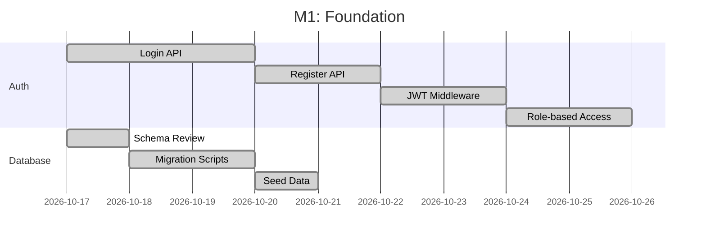
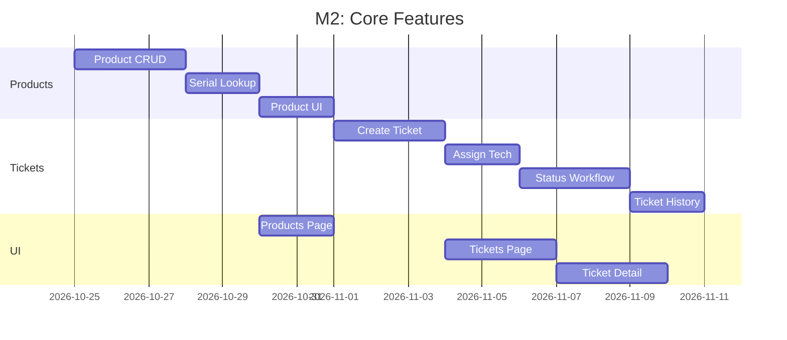
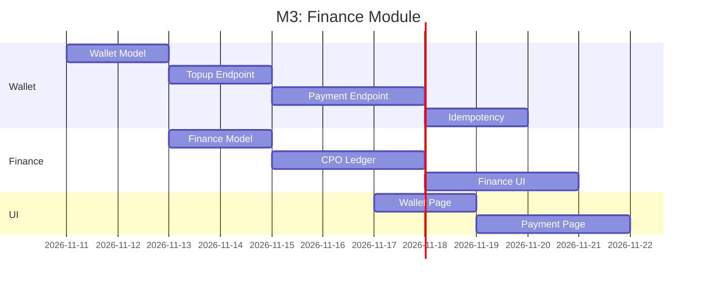
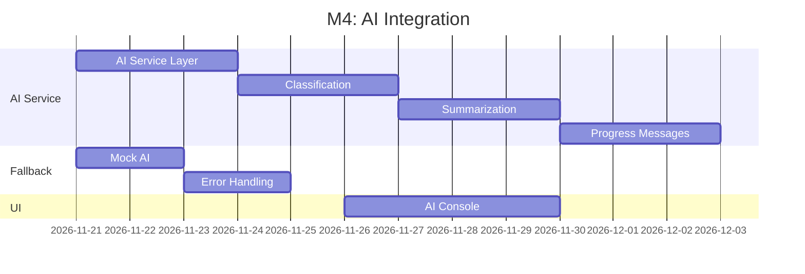
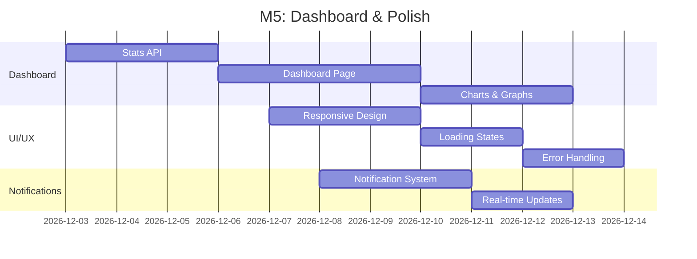
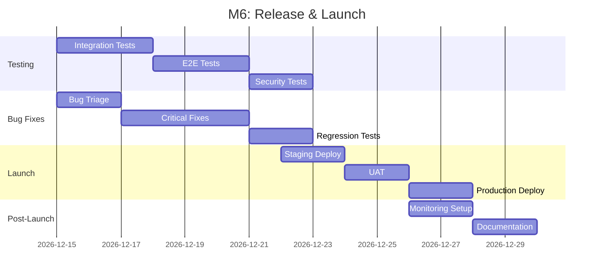
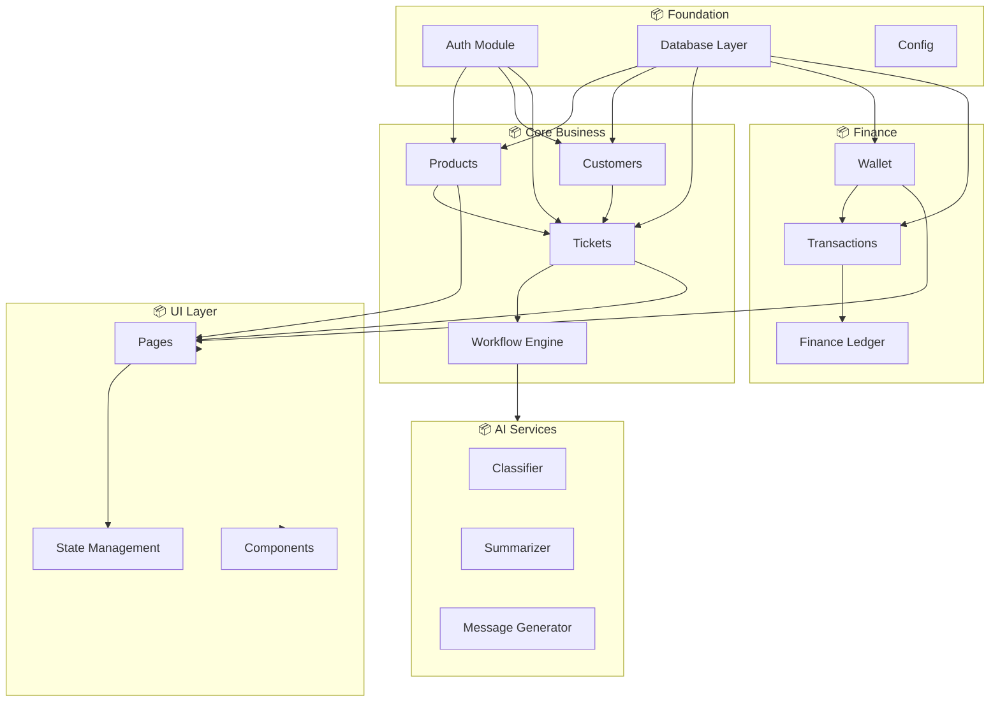
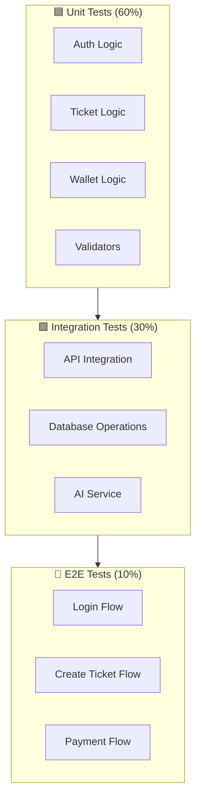
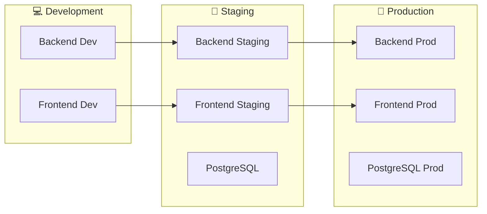

# KẾ HOẠCH TRIỂN KHAI CHI TIẾT
# HỆ THỐNG QUẢN LÝ BẢO HÀNH TÍCH HỢP AI

> **Phiên bản:** v1.0
> **Ngày tạo:** 2026-10-17
> **Trạng thái:** Kế hoạch dự kiến

---

## MỤC LỤC

1. [Tổng quan kế hoạch](#1-tổng-quan-kế-hoạch)
2. [Milestones & Deliverables](#2-milestones--deliverables)
3. [Resource Planning](#3-resource-planning)
4. [Dependency Map](#4-dependency-map)
5. [Risk Management](#5-risk-management)
6. [Testing Strategy](#6-testing-strategy)
7. [Deployment Plan](#7-deployment-plan)
8. [Maintenance Plan](#8-maintenance-plan)

---

## 1. TỔNG QUAN KẾ HOẠCH

### 1.1 Thông tin dự án

| Thông tin | Chi tiết |
|-----------|----------|
| Tên dự án | BảoHành Pro |
| Version | v2.0 |
| Ngày bắt đầu | 2026-10-17 |
| Ngày dự kiến hoàn thành | 2026-11-30 |
| Tổng thời gian | 6 tuần |
| Team size | 1-2 developers |
| Methodology | Agile (Sprints 2 tuần) |

### 1.2 Timeline tổng quan

```
Week 1-2  │ Week 3-4  │ Week 5-6  │ Week 7-8  │ Week 9-10 │ Week 11-12
──────────┼───────────┼───────────┼───────────┼───────────┼───────────
Foundation │ Core      │ Finance   │ AI        │ Dashboard │ Polish & 
          │ Features   │          │ Features  │          │ Launch
          │           │          │           │           │
Sprint 1  │ Sprint 2  │ Sprint 3  │ Sprint 4  │ Sprint 5  │ Sprint 6
──────────┴───────────┴───────────┴───────────┴───────────┴───────────
          │           │          │           │           │
M1        │ M2        │ M3       │ M4        │ M5        │ M6
          │           │          │           │           │
Alpha      │ Beta      │ RC1      │ RC2       │ Release   │ Post-
Release    │ Feature   │ Finance  │ AI        │ Candidate │ Launch
```

---

## 2. MILESTONES & DELIVERABLES

### 2.1 Milestone 1: Foundation (End of Week 2)

**Mục tiêu:** Xây dựng nền tảng xác thực và cơ sở dữ liệu



**Deliverables:**
- [x] Login/Register endpoints với JWT
- [x] RBAC middleware
- [x] Database schema với migrations
- [x] API documentation (OpenAPI)
- [x] Unit tests (67/67 passing)

**Định nghĩa hoàn thành:**
- Tất cả endpoints auth trả về đúng HTTP status
- JWT token có thể dùng để access protected routes
- Role-based access được enforce ở backend

---

### 2.2 Milestone 2: Core Features (End of Week 4)

**Mục tiêu:** Hoàn thành CRUD sản phẩm và workflow phiếu bảo hành



**Deliverables:**
- [ ] Product management (CRUD)
- [ ] Serial lookup với serial number
- [ ] Ticket creation với warranty check
- [ ] Technician assignment
- [ ] Status workflow (RECEIVED → INSPECTION → REPAIRING → COMPLETED/REJECTED)
- [ ] Ticket history tracking

**Định nghĩa hoàn thành:**
- Staff có thể tạo phiếu từ serial
- Hệ thống tự động kiểm tra điều kiện bảo hành
- Mọi thay đổi trạng thái được ghi lại trong history

---

### 2.3 Milestone 3: Finance Module (End of Week 6)

**Mục tiêu:** Hoàn thành ví và sổ tài chính



**Deliverables:**
- [ ] Wallet với balance tracking
- [ ] Topup với idempotency
- [ ] Payment với race condition protection
- [ ] Finance ledger cho admin
- [ ] Transaction history

**Định nghĩa hoàn thành:**
- 2 concurrent payment requests không trừ tiền 2 lần
- Số dư không bao giờ âm
- Mọi giao dịch có audit trail

---

### 2.4 Milestone 4: AI Integration (End of Week 8)

**Mục tiêu:** Tích hợp AI cho phân loại, tóm tắt và tin nhắn



**Deliverables:**
- [ ] AI service với Gemini API integration
- [ ] Mock fallback khi API unavailable
- [ ] Issue classification (5 categories)
- [ ] Ticket summarization
- [ ] Progress message generation
- [ ] Anonymizer cho PII data

**Định nghĩa hoàn thành:**
- AI classification có thể fallback về mock
- Không gửi PII data cho AI provider
- AI không quyết định quyền bảo hành

---

### 2.5 Milestone 5: Dashboard & Polish (End of Week 10)

**Mục tiêu:** Dashboard thống kê và hoàn thiện UX



**Deliverables:**
- [ ] Dashboard với thống kê tổng quan
- [ ] Top issues chart
- [ ] Status distribution chart
- [ ] Processing time metrics
- [ ] Notification system
- [ ] Responsive design

**Định nghĩa hoàn thành:**
- Dashboard load < 500ms
- Tất cả charts có loading states
- Responsive trên mobile và desktop

---

### 2.6 Milestone 6: Release & Launch (End of Week 12)

**Mục tiêu:** Final testing, bug fixes và production deployment



**Deliverables:**
- [ ] All tests passing (>90% coverage)
- [ ] Security audit completed
- [ ] Staging deployment verified
- [ ] User acceptance testing
- [ ] Production deployment
- [ ] Monitoring & alerting setup
- [ ] Complete documentation

**Định nghĩa hoàn thành:**
- 100% critical bugs resolved
- Security scan clean
- Production deployment successful
- Runbook available

---

## 3. RESOURCE PLANNING

### 3.1 Team Composition

| Role | Name | Responsibilities |
|------|------|------------------|
| Lead Developer | TBD | Architecture, Backend, API |
| Frontend Developer | TBD | UI/UX, Components |
| QA Engineer | TBD | Testing, Bug reports |
| Product Owner | Stakeholder | Requirements, Priorities |

### 3.2 Time Allocation (Hours)

| Phase | Backend | Frontend | Testing | Docs | Total |
|-------|--------|----------|---------|------|-------|
| Foundation | 40 | 16 | 16 | 8 | 80 |
| Core | 48 | 32 | 24 | 8 | 112 |
| Finance | 32 | 24 | 16 | 4 | 76 |
| AI | 40 | 16 | 16 | 8 | 80 |
| Dashboard | 24 | 32 | 12 | 4 | 72 |
| Polish | 16 | 24 | 24 | 12 | 76 |
| **Total** | **200** | **144** | **108** | **44** | **496** |

### 3.3 Infrastructure Requirements

| Resource | Dev | Staging | Production |
|----------|-----|---------|------------|
| Backend Server | Local | 2GB RAM | 4GB RAM |
| Database | SQLite | PostgreSQL 2Core | PostgreSQL 4Core |
| Frontend CDN | Local | CDN | CDN |
| AI API | Mock | Gemini API | Gemini API |
| Monitoring | None | Logs only | Full stack |

---

## 4. DEPENDENCY MAP

### 4.1 Module Dependencies



### 4.2 Technical Dependencies

```yaml
# Frontend dependencies (package.json)
dependencies:
  react: "^18.2.0"
  react-dom: "^18.2.0"
  react-router-dom: "^6.20.0"
  axios: "^1.6.0"
  tailwindcss: "^3.4.0"
  framer-motion: "^11.0.0"
  supabase-js: "^2.117.0"

devDependencies:
  vite: "^5.0.0"
  eslint: "^8.0.0"
  pytest: "^7.4.0"

# Backend dependencies (requirements.txt)
dependencies:
  fastapi: "^0.104.0"
  uvicorn: "^0.24.0"
  sqlalchemy: "^2.0.0"
  pydantic: "^2.0.0"
  python-jose: "^3.3.0"
  passlib: "^1.7.0"
  bcrypt: "^4.0.0"
  python-multipart: "^0.0.6"
  google-generativeai: "^0.3.0"
```

---

## 5. RISK MANAGEMENT

### 5.1 Risk Assessment Matrix

```mermaid
quadrantChart
    title Risk Assessment Matrix
    x-axis Probability --> Impact
    y-axis Severity --> Priority
    
    quadrant-1 High Priority
    quadrant-2 Monitor
    quadrant-3 Contingency
    quadrant-4 Accept
    
    R01: [0.7, 0.8, "Security Breach"]
    R02: [0.3, 0.9, "Data Loss"]
    R03: [0.5, 0.6, "AI Service Down"]
    R04: [0.4, 0.7, "Performance Issue"]
    R05: [0.2, 0.8, "Migration Failure"]
    R06: [0.6, 0.4, "Scope Creep"]
```

### 5.2 Risk Mitigation Plans

| Risk | Mitigation Strategy | Contingency |
|------|--------------------|-------------|
| Security Breach | Encryption, audit log, penetration testing | Incident response plan |
| Data Loss | Daily backups, point-in-time recovery | Data restoration procedure |
| AI Service Down | Mock fallback mode | Manual classification temporarily |
| Performance Issue | Indexing, caching, load testing | Scale up resources |
| Migration Failure | Dry run, rollback plan | Manual data migration |
| Scope Creep | Strict change management | Re-prioritize backlog |

---

## 6. TESTING STRATEGY

### 6.1 Testing Pyramid



### 6.2 Test Coverage Goals

| Module | Coverage Target | Critical Tests |
|--------|---------------|---------------|
| Auth | 95% | Login, Register, JWT validation |
| Products | 85% | CRUD, Serial lookup |
| Tickets | 90% | Create, Status workflow, History |
| Wallet | 95% | Topup, Payment, Idempotency |
| AI | 70% | Mock fallback, Anonymizer |

### 6.3 Test Execution Plan

```yaml
# CI Pipeline
test:
  stages:
    - lint
    - unit
    - integration
    - e2e
    
  lint:
    script:
      - eslint frontend/src
      - ruff check backend/app
      
  unit:
    script:
      - pytest backend/tests/unit -v
      - vitest frontend/src --coverage
      
  integration:
    script:
      - pytest backend/tests/integration -v
      - docker-compose up test-db
      
  e2e:
    script:
      - playwright test
    when: manual
```

---

## 7. DEPLOYMENT PLAN

### 7.1 Environment Strategy



### 7.2 Deployment Checklist

```markdown
## Pre-Deployment Checklist

### Code
- [ ] All tests passing
- [ ] No security vulnerabilities
- [ ] Code review approved
- [ ] Changelog updated

### Database
- [ ] Migration scripts tested
- [ ] Backup created
- [ ] Rollback plan verified

### Infrastructure
- [ ] Environment variables configured
- [ ] SSL certificates ready
- [ ] CDN configured
- [ ] Monitoring enabled

### Communication
- [ ] Stakeholders notified
- [ ] Support team ready
- [ ] Documentation updated
```

### 7.3 Rollback Procedure

```bash
# Quick rollback commands
git revert HEAD
docker-compose down
docker-compose up -d

# Database rollback
alembic downgrade -1
```

---

## 8. MAINTENANCE PLAN

### 8.1 Support Tiers

| Tier | Response Time | Examples |
|------|-------------|----------|
| Critical | 1 hour | System down, data loss |
| High | 4 hours | Major feature broken |
| Medium | 24 hours | Minor bug, UI issue |
| Low | 1 week | Feature request |

### 8.2 Maintenance Schedule

| Activity | Frequency | Owner |
|----------|-----------|-------|
| Security patches | As needed | Dev team |
| Dependency updates | Monthly | Dev team |
| Database optimization | Weekly | Dev team |
| Log review | Daily | Ops team |
| Backup verification | Weekly | Ops team |
| Performance review | Monthly | Dev team |

### 8.3 Monitoring Dashboard

```yaml
# Key Metrics to Monitor
metrics:
  uptime:
    target: 99.9%
    alert_threshold: 99%
    
  response_time:
    p50_target: <100ms
    p95_target: <500ms
    p99_target: <1000ms
    
  error_rate:
    target: <0.1%
    alert_threshold: 1%
    
  database:
    connection_pool: <80%
    slow_queries: <5/min
    
  business:
    tickets_created: daily
    tickets_completed: daily
    active_users: daily
```

---

## APPENDIX

### A. Definition of Done Checklist

- [ ] Code written and peer-reviewed
- [ ] Unit tests written and passing
- [ ] Integration tests written and passing
- [ ] Code follows coding standards
- [ ] No security vulnerabilities
- [ ] Documentation updated
- [ ] Changelog updated
- [ ] Product Owner accepted

### B. Sprint Retrospective Template

```markdown
# Sprint Retrospective - Sprint #[N]

## What went well
-

## What could be improved
-

## Action items for next sprint
-

## Team velocity
- Planned: X points
- Completed: Y points
- Velocity: Z%
```

### C. Incident Report Template

```markdown
# Incident Report - [ID]

## Summary
-

## Impact
-

## Timeline
-

## Root Cause
-

## Resolution
-

## Follow-up Actions
-
```

---

**Document Status:** Draft
**Last Updated:** 2026-10-17
**Next Review:** 2026-10-24
