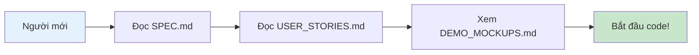
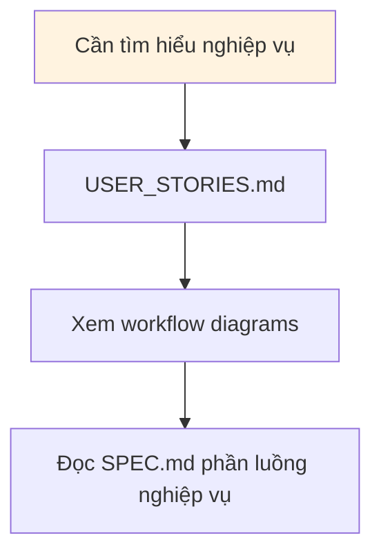
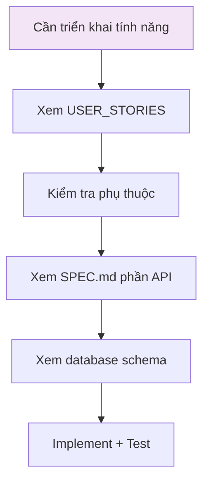
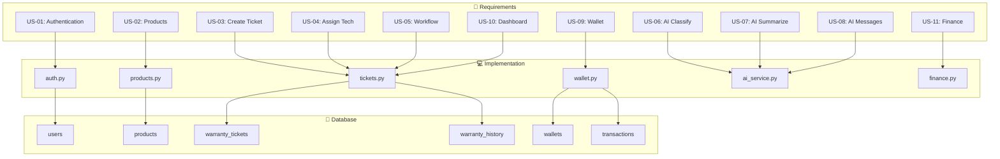
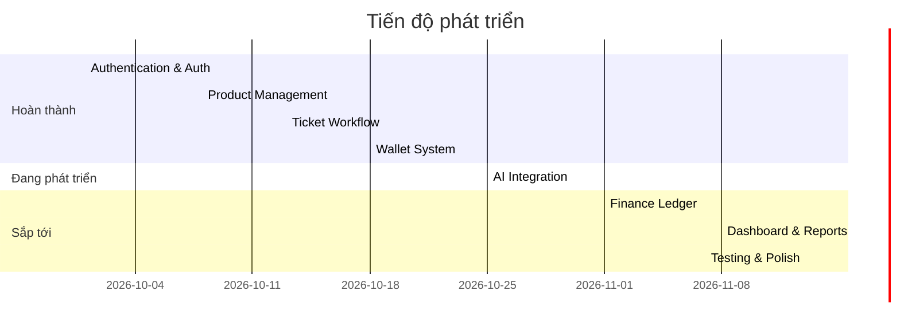

# 📚 TÀI LIỆU DỰ ÁN BẢO HÀNH PRO

> **Mục lục tổng hợp** - Tất cả tài liệu kỹ thuật và nghiệp vụ

---

## 📋 ĐẶC TẢ CHÍNH

| File | Mô tả | Phiên bản | Cập nhật |
|------|--------|-----------|-----------|
| [SPEC.md](./SPEC.md) | **Đặc tả kỹ thuật toàn diện** - Kiến trúc, database, API, user stories | v2.0 | 2026-10-17 |
| [IMPLEMENTATION_PLAN.md](./IMPLEMENTATION_PLAN.md) | **Kế hoạch triển khai** - Milestones, resource, risk management | v1.0 | 2026-10-17 |
| [DEMO_MOCKUPS.md](./DEMO_MOCKUPS.md) | **Mockups & Wireframes** - Hình ảnh demo giao diện | v1.0 | 2026-10-17 |

---

## 📖 HƯỚNG DẪN ĐỌC

### 1. Nếu bạn mới tham gia dự án



**Thứ tự đọc đề xuất:**
1. `SPEC.md` - Tổng quan hệ thống
2. `USER_STORIES.md` - Yêu cầu chi tiết
3. `DEMO_MOCKUPS.md` - Hình ảnh minh họa
4. `IMPLEMENTATION_PLAN.md` - Kế hoạch phát triển

### 2. Nếu bạn cần tìm hiểu nghiệp vụ



### 3. Nếu bạn cần triển khai tính năng mới



---

## 📁 CẤU TRÚC TÀI LIỆU

```
docs/
├── 📄 INDEX.md                    ← File này
│
├── 📋 ĐẶC TẢ CHÍNH
│   ├── SPEC.md                    ← Đặc tả kỹ thuật (TÀI LIỆU CHÍNH)
│   ├── IMPLEMENTATION_PLAN.md     ← Kế hoạch triển khai
│   └── DEMO_MOCKUPS.md            ← Mockups & wireframes
│
├── 📝 USER STORIES
│   ├── USER_STORIES.md            ← Danh sách user stories
│   ├── OPEN_QUESTIONS.md          ← Câu hỏi chưa xác nhận
│   └── Work.md                    ← Work log
│
├── 🔒 BẢO MẬT
│   ├── SECURITY_AUDIT.md          ← Audit bảo mật
│   ├── SECURITY_ROADMAP.md         ← Lộ trình bảo mật
│   └── MULTI_TENANT_PLAN.md       ← Kế hoạch multi-tenant
│
├── 🔍 REVIEW & AUDIT
│   ├── UX_AUDIT.md                ← Audit UX/UI
│   └── AUDIT_REPORT.md            ← Báo cáo audit
│
└── 📊 PROGRESS
    └── PROGRESS_SUMMARY_2026-10-04.md ← Tiến độ
```

---

## 🎯 MAP: YÊU CẦU → USER STORY → IMPLEMENTATION



---

## 🔗 LIÊN KẾT NHANH

### Backend API

| Module | File | Mô tả |
|--------|------|--------|
| Auth | `app/api/v1/endpoints/auth.py` | Login, Register, JWT |
| Products | `app/api/v1/endpoints/products.py` | CRUD, Serial lookup |
| Tickets | `app/api/v1/endpoints/tickets.py` | Create, Status, Assignment |
| Wallet | `app/api/v1/endpoints/wallet.py` | Balance, Topup, Payment |
| AI | `app/api/v1/endpoints/ai.py` | Classify, Summarize, Messages |
| Finance | `app/api/v1/endpoints/finance.py` | Ledger, Reports |

### Frontend Pages

| Trang | File | Vai trò |
|-------|------|---------|
| Login | `src/pages/Login.jsx` | Public |
| Dashboard | `src/pages/Dashboard.jsx` | Admin, Staff |
| Products | `src/pages/Products.jsx` | Admin, Staff |
| Tickets | `src/pages/Tickets.jsx` | All |
| Wallet | `src/pages/Wallet.jsx` | Customer |
| AI Console | `src/pages/AIConsole.jsx` | Admin, Staff, Technician |

---

## 📊 TRẠNG THÁI DỰ ÁN



---

## 🆘 HỖ TRỢ

### Câu hỏi thường gặp

**Q: Làm sao để chạy project?**
```bash
# Backend
cd warranty-system/backend
pip install -r requirements.txt
uvicorn app.main:app --reload

# Frontend  
cd warranty-system/frontend
npm install
npm run dev
```

**Q: Database schema ở đâu?**
A: Xem `SPEC.md` phần 3 (Mô hình dữ liệu) hoặc source code trong `app/models/`

**Q: API documentation ở đâu?**
A: Sau khi chạy backend, truy cập `http://localhost:8000/docs`

**Q: Làm sao để test?**
```bash
# Backend tests
cd warranty-system/backend
pytest tests/ -v

# Frontend tests  
cd warranty-system/frontend
npm test
```

---

## 📝 CONTRIBUTING

Khi thêm/chỉnh sửa tài liệu:

1. Cập nhật file tương ứng trong `docs/`
2. Cập nhật `CHANGELOG.md` nếu có
3. Đảm bảo các file liên kết đúng đường dẫn
4. Commit với message rõ ràng

---

## 📞 LIÊN HỆ

| Vai trò | Người | Liên hệ |
|---------|-------|---------|
| Project Lead | TBD | TBD |
| Backend Lead | TBD | TBD |
| Frontend Lead | TBD | TBD |

---

**Document Version:** v1.0
**Last Updated:** 2026-10-17
**Next Review:** 2026-10-24
