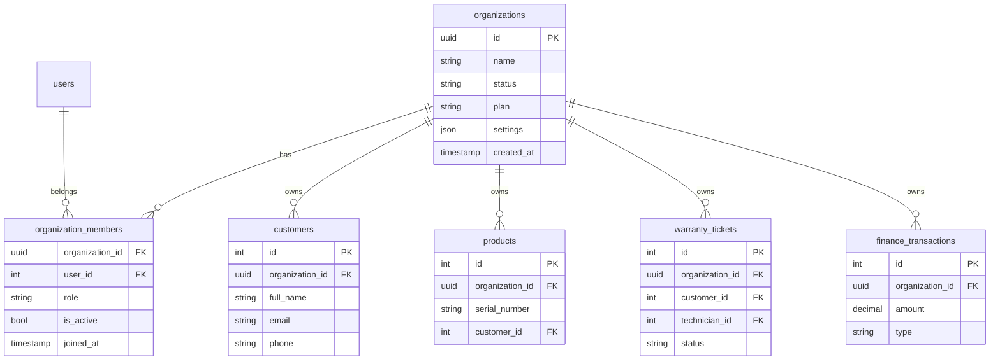

# KẾ HOẠCH TRIỂN KHAI MULTI-TENANT — Hệ thống Quản lý Bảo hành

**Giai đoạn:** Phase 1 — Thiết kế (chưa triển khai code)
**Phương án:** Shared database + bảng `organizations` riêng + bảng `organization_members` (multi-membership)
**Trạng thái:** Chờ duyệt

---

## 1. Mục tiêu

Chuyển hệ thống từ mô hình **single-tenant** (1 tổ chức duy nhất, mọi user dùng chung dữ liệu) sang **multi-tenant SaaS** trong đó:

- Mỗi tổ chức (`organization`) có dữ liệu riêng: sản phẩm, phiếu bảo hành, khách hàng, giao dịch ví.
- Một người dùng có thể thuộc nhiều tổ chức với vai trò khác nhau ở mỗi tổ chức.
- Mỗi tổ chức có thể quản lý trạng thái, gói dịch vụ, cấu hình độc lập.

---

## 2. Phương án kiến trúc

### 2.1. Sơ đồ khái niệm (ERD)



**Lưu ý:**
- `organization_members` dùng composite primary key `(organization_id, user_id)`.
- `role` trong `organization_members` có giá trị: `org_admin`, `org_staff`, `org_technician`, `org_viewer`.
- `organizations.id` dùng `UUID` để tránh đoán `id` khi tạo (bảo mật) và cho phép mở rộng phân tán sau này.

### 2.2. So sánh với phương án "thêm `organization_name` vào `users`"

| Tiêu chí | Bảng `organizations` riêng | Thêm `organization_name` vào `users` |
|---|---|---|
| 1 user thuộc nhiều tổ chức | ✅ thông qua `organization_members` | ❌ 1 user chỉ thuộc 1 tổ chức |
| Quản lý trạng thái, gói dịch vụ tổ chức | ✅ dễ dàng (cột trong `organizations`) | ❌ phải thêm cột cho mỗi user |
| Phân quyền theo tổ chức | ✅ role trong `organization_members` | ❌ chỉ có 1 role trên user |
| Khả năng mở rộng SaaS | ✅ | ❌ giới hạn |
| Phù hợp ngữ cảnh này | **Chọn** (vì đã chốt multi-membership) | — |

### 2.3. Giải thích kỹ thuật

**Composite FK:** Khi thêm `organization_id` vào bảng `products`, FK sẽ là `(organization_id, customer_id) → users` không trực tiếp mà đi qua `customers.organization_id` để đảm bảo customer và product cùng tổ chức.

**Tenant isolation 3 lớp:**
1. **Application layer:** mọi query phải filter theo `organization_id` lấy từ `current_user.active_organization_id`.
2. **Database layer:** dùng Row-Level Security (RLS) của Postgres.
3. **API layer:** middleware kiểm tra token có chứa `active_organization_id` không.

**Role scope:**
- `role` trên `users` (global) — dùng cho hệ thống cấp cao (super admin, system).
- `role` trong `organization_members` — dùng cho từng tổ chức.

---

## 3. Thay đổi cấu trúc dữ liệu

### 3.1. Bảng mới

**`organizations`**
```sql
CREATE TABLE organizations (
    id UUID PRIMARY KEY DEFAULT gen_random_uuid(),
    name VARCHAR(200) NOT NULL,
    status VARCHAR(20) NOT NULL DEFAULT 'active',  -- active | suspended | deleted
    plan VARCHAR(50) NOT NULL DEFAULT 'trial',     -- trial | basic | pro | enterprise
    settings JSONB NOT NULL DEFAULT '{}'::jsonb,   -- branding, feature flags, ...
    created_at TIMESTAMPTZ NOT NULL DEFAULT NOW(),
    updated_at TIMESTAMPTZ NOT NULL DEFAULT NOW()
);
```

**`organization_members`**
```sql
CREATE TABLE organization_members (
    organization_id UUID NOT NULL REFERENCES organizations(id) ON DELETE CASCADE,
    user_id INTEGER NOT NULL REFERENCES users(id) ON DELETE CASCADE,
    role VARCHAR(30) NOT NULL,  -- org_admin | org_staff | org_technician | org_viewer
    is_active BOOLEAN NOT NULL DEFAULT TRUE,
    joined_at TIMESTAMPTZ NOT NULL DEFAULT NOW(),
    PRIMARY KEY (organization_id, user_id)
);
CREATE INDEX idx_org_members_user ON organization_members(user_id);
CREATE INDEX idx_org_members_org_role ON organization_members(organization_id, role);
```

### 3.2. Bảng sửa — thêm `organization_id` (NOT NULL)

| Bảng | Cột thêm | FK mới | Composite FK mới |
|---|---|---|---|
| `products` | `organization_id` | → `organizations.id` | `(organization_id, customer_id) → (organizations.id, users.id)` (qua `customers`) |
| `customers` | `organization_id` | → `organizations.id` | — |
| `warranty_tickets` | `organization_id` | → `organizations.id` | `(organization_id, customer_id, technician_id)` |
| `finance_transactions` | `organization_id` | → `organizations.id` | — |

**Bảng KHÔNG thêm `organization_id`** (vì toàn cục):
- `users` — bảng global, mỗi user là duy nhất trong hệ thống
- `wallets`, `transactions` — ví cá nhân, theo `user_id`
- `notifications` — theo `user_id`
- `warranty_history` — theo ticket (đã có `organization_id` qua FK)

**Lý do giữ `wallets` toàn cục:** Ví là tài sản cá nhân của user, không thuộc tổ chức. Nếu tổ chức A trả tiền cho phiếu bảo hành của khách, tiền trừ từ ví user, không phải ví tổ chức.

### 3.3. Bảng tham chiếu

| Bảng cũ | Tham chiếu sau multi-tenant |
|---|---|
| `Product.customer_id` | Đổi FK thành composite `(organization_id, customer_id) → (organizations.id, users.id)` |
| `WarrantyTicket.customer_id` | Tương tự |
| `WarrantyTicket.technician_id` | Phải verify `user` có `organization_member` với role `org_technician` trong cùng `organization_id` |
| `WarrantyHistory.technician_id` | Tương tự |

---

## 4. Thay đổi API & xác thực

### 4.1. JWT payload

Thêm `active_organization_id` vào JWT.

**Trước:**
```json
{"sub": "42", "exp": 1234567890, "role": "admin"}
```

**Sau:**
```json
{
    "sub": "42",
    "exp": 1234567890,
    "role": "admin",
    "active_organization_id": "uuid-here",
    "org_role": "org_admin"
}
```

**Lưu ý:** Sau khi fix M6 (xóa `role` khỏi payload), `active_organization_id` cũng có thể lookup lại từ DB để tránh stale data. Cân nhắc: lookup mỗi request (tốn query) hay cache trong token (risk stale).

### 4.2. Endpoint mới

| Method | Path | Mục đích | Role |
|---|---|---|---|
| `GET` | `/organizations/me` | Lấy danh sách tổ chức user thuộc về | any user |
| `POST` | `/organizations/me/switch` | Đổi `active_organization_id` | any user |
| `POST` | `/organizations` | Tạo tổ chức mới (kèm tạo `organization_members` cho người tạo) | any user (sẽ là `org_admin`) |
| `POST` | `/organizations/{id}/members` | Thêm user vào tổ chức | `org_admin` |
| `DELETE` | `/organizations/{id}/members/{user_id}` | Xóa user khỏi tổ chức | `org_admin` |
| `PUT` | `/organizations/{id}/members/{user_id}/role` | Đổi role trong tổ chức | `org_admin` |
| `GET` | `/organizations/{id}/members` | Liệt kê thành viên | `org_admin`, `org_staff` |

### 4.3. Endpoint sửa — bắt buộc có `active_organization_id`

Tất cả endpoint hiện tại (trừ `/auth/*` và `/tickets/public/*`) phải:
1. Verify token có `active_organization_id`.
2. Verify user là `organization_member` active của tổ chức đó.
3. Mọi query SELECT/INSERT/UPDATE/DELETE đều filter theo `organization_id`.

**Helper cần tạo:**
- `app/core/tenant.py::get_current_org_member()` — trả `(organization, membership)` từ JWT.
- `app/core/tenant.py::require_org_role(*allowed_roles)` — decorator tương tự `require_roles` nhưng check role trong tổ chức.

---

## 5. Kế hoạch triển khai (4 bước)

### Bước 1 — Chuẩn bị dữ liệu (an toàn, không phá vỡ)

1. Tạo 1 tổ chức mặc định `DEFAULT_ORG_ID` (UUID cố định, dùng env).
2. Insert vào `organizations` 1 row tương ứng.
3. Với mỗi `user` hiện có, thêm row vào `organization_members` với role mapping từ `users.role`:
   - `admin` → `org_admin`
   - `staff` → `org_staff`
   - `technician` → `org_technician`
   - `customer` → `org_viewer`
4. Backup database **trước khi chạy migration**.

**Lệnh backup (Postgres):**
```bash
docker exec warranty_db pg_dump -U admin warranty_db > backup_$(date +%Y%m%d).sql
```

### Bước 2 — Thêm cột (nullable trước)

Thêm `organization_id` vào các bảng hiện có, **nullable tạm thời**, default = `DEFAULT_ORG_ID`.

```sql
ALTER TABLE products ADD COLUMN organization_id UUID;
ALTER TABLE customers ADD COLUMN organization_id UUID;
ALTER TABLE warranty_tickets ADD COLUMN organization_id UUID;
ALTER TABLE finance_transactions ADD COLUMN organization_id UUID;

UPDATE products SET organization_id = 'DEFAULT_ORG_ID';
UPDATE customers SET organization_id = 'DEFAULT_ORG_ID';
UPDATE warranty_tickets SET organization_id = 'DEFAULT_ORG_ID';
UPDATE finance_transactions SET organization_id = 'DEFAULT_ORG_ID';
```

### Bước 3 — Bật NOT NULL + FK + Index

```sql
ALTER TABLE products ALTER COLUMN organization_id SET NOT NULL;
ALTER TABLE products ADD CONSTRAINT fk_products_org FOREIGN KEY (organization_id) REFERENCES organizations(id);
CREATE INDEX idx_products_org ON products(organization_id);

-- Tương tự cho customers, warranty_tickets, finance_transactions
```

**Lỗ hổng cần tránh:** nếu update dữ liệu cũ trước khi set NOT NULL bị lỗi, các bản ghi cũ sẽ có `organization_id = NULL` → vi phạm ràng buộc. **Phải chạy UPDATE trước, SET NOT NULL sau**.

### Bước 4 — Bật RLS (Row-Level Security)

```sql
ALTER TABLE products ENABLE ROW LEVEL SECURITY;
CREATE POLICY products_tenant_isolation ON products
    USING (organization_id = current_setting('app.current_organization_id')::uuid);
```

**Cấu hình trong SQLAlchemy session:**
```python
db.execute("SET app.current_organization_id = :org_id", {"org_id": str(org_id)})
```

---

## 6. Rủi ro & biện pháp giảm thiểu

| Rủi ro | Mức | Biện pháp |
|---|---|---|
| Migration làm mất dữ liệu | Cao | Backup bắt buộc trước khi chạy; chạy trên staging trước |
| Dữ liệu mồ côi (record không có `organization_id`) | Cao | UPDATE tất cả về `DEFAULT_ORG_ID` trước khi SET NOT NULL |
| RLS bypass khi query từ migration script | Trung bình | Dùng role `migration` không bật RLS; app dùng role khác |
| Performance giảm khi filter thêm `organization_id` | Trung bình | Index `(organization_id, ...)` cho mọi truy vấn |
| Stale `active_organization_id` trong JWT | Thấp | Cân nhắc refresh token khi đổi org |
| Frontend chưa đổi `active_organization_id` khi user switch | Trung bình | Interceptor axios tự động gắn header `X-Organization-Id` |

---

## 7. Checklist file cần sửa (khi sang Phase 2)

### Backend

| File | Thay đổi |
|---|---|
| `app/models/organization.py` (mới) | Model `Organization` + `OrganizationMember` |
| `app/models/product.py` | Thêm `organization_id` FK |
| `app/models/user.py` (model cho `customers`) | Tách `Customer` riêng hoặc thêm `organization_id` vào `User` (cân nhắc) |
| `app/models/warranty.py` | Thêm `organization_id` FK vào `WarrantyTicket` |
| `app/models/finance.py` | Thêm `organization_id` FK |
| `app/core/tenant.py` (mới) | Helper `get_current_org_member`, `require_org_role` |
| `app/core/security.py` | Thêm `active_organization_id` vào JWT payload |
| `app/api/v1/endpoints/organizations.py` (mới) | 7 endpoint mới |
| `app/api/v1/endpoints/products.py` | Filter theo `organization_id` |
| `app/api/v1/endpoints/customers.py` | Filter theo `organization_id` |
| `app/api/v1/endpoints/tickets.py` | Filter theo `organization_id`, thêm ownership check |
| `app/api/v1/endpoints/finance.py` | Filter theo `organization_id` |
| `app/services/warranty_service.py` | Nhận `organization_id` làm tham số, truyền vào mọi query |
| `app/services/finance_service.py` | Tương tự |
| `migrations/001_add_organizations.sql` (mới) | 4 bước migration ở mục 5 |

### Frontend

| File | Thay đổi |
|---|---|
| `src/context/AuthContext.jsx` | Lưu `active_organization_id` trong state, có hàm `switchOrganization` |
| `src/components/OrganizationSwitcher.jsx` (mới) | UI chọn tổ chức |
| `src/components/Layout.jsx` | Hiển thị OrganizationSwitcher trên header |
| `src/services/api.js` | Interceptor gắn `X-Organization-Id` header |
| `src/pages/OrganizationSettings.jsx` (mới) | Trang quản lý thành viên (admin tổ chức) |
| `src/pages/Customers.jsx`, `Products.jsx`, `Tickets.jsx`, `Payment.jsx` | Tự động refactor theo `active_organization_id` (không cần đổi logic filter nếu backend đã filter) |

---

## 8. Tiêu chí hoàn thành (Definition of Done)

Phase 1 (thiết kế — file này) hoàn thành khi:
- [x] Phương án kiến trúc đã được chốt với user.
- [x] ERD đã được vẽ.
- [x] Danh sách bảng mới, bảng sửa, cột mới đã liệt kê.
- [x] Kế hoạch migration 4 bước đã viết.
- [x] Rủi ro và biện pháp giảm thiểu đã nêu.
- [x] Checklist file cần sửa đã liệt kê.

Phase 2 (triển khai) hoàn thành khi:
- [ ] Migration script đã chạy thành công trên staging với dữ liệu thật.
- [ ] Backup đã verify có thể restore.
- [ ] RLS đã bật và test cách ly đã pass.
- [ ] Tất cả test hiện tại vẫn pass.
- [ ] Bổ sung test multi-tenant:
  - [ ] `test_tenant_isolation_products`
  - [ ] `test_tenant_isolation_tickets`
  - [ ] `test_tenant_isolation_finance`
  - [ ] `test_organization_member_cannot_access_other_org`
  - [ ] `test_switch_organization_changes_visible_data`

---

## 9. Câu hỏi còn mở (cần user xác nhận trước Phase 2)

1. **`User` và `Customer`**: hiện tại `User.role = "customer"` đóng vai trò khách hàng. Khi multi-tenant, có cần tách `Customer` thành bảng riêng (có `organization_id`) hay giữ chung `User` với `role` cố định là `customer`? **Đề xuất: giữ chung**, thêm `organization_id` vào `users` (cùng với role toàn cục).

2. **Kế hoạch dữ liệu cũ**: nếu đã có dữ liệu thật (không phải seed), quy trình backfill là tạo 1 tổ chức mặc định `LEGACY_ORG` rồi gán tất cả record cũ vào đó. User có đồng ý?

3. **Wallet và Transaction**: như đã nêu, ví giữ global theo `user_id`. Nếu tổ chức muốn quản lý ngân sách riêng (escrow), cần thêm bảng `org_wallets` riêng. Có cần tính năng này không? **Mặc định: không cần** cho Phase 2.

4. **AI Console (`/ai`)**: hiện tại `/ai` cho cả 3 role (admin/staff/technician). Khi multi-tenant, AI có dùng chung hay riêng từng tổ chức? **Mặc định: chung** (anonymizer đã ẩn thông tin tổ chức).

5. **Public lookup** (`/tickets/public/{ticket_code}`): khi multi-tenant, phiếu của tổ chức A có thể lookup bởi tổ chức B? **Mặc định: KHÔNG** — chỉ phiếu cùng tổ chức hoặc đã share công khai.

---

**Đồng thuận:** Tài liệu này là thiết kế, chưa có code. Mọi thay đổi thực tế ở Phase 2 phải qua review và có backup trước khi chạy migration.
