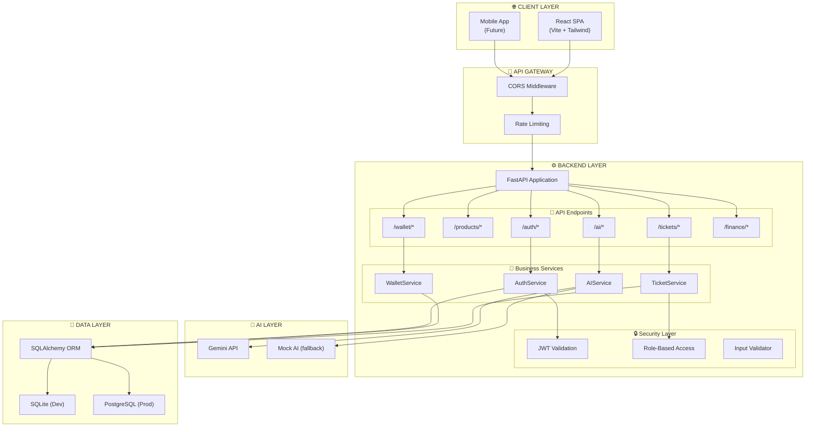
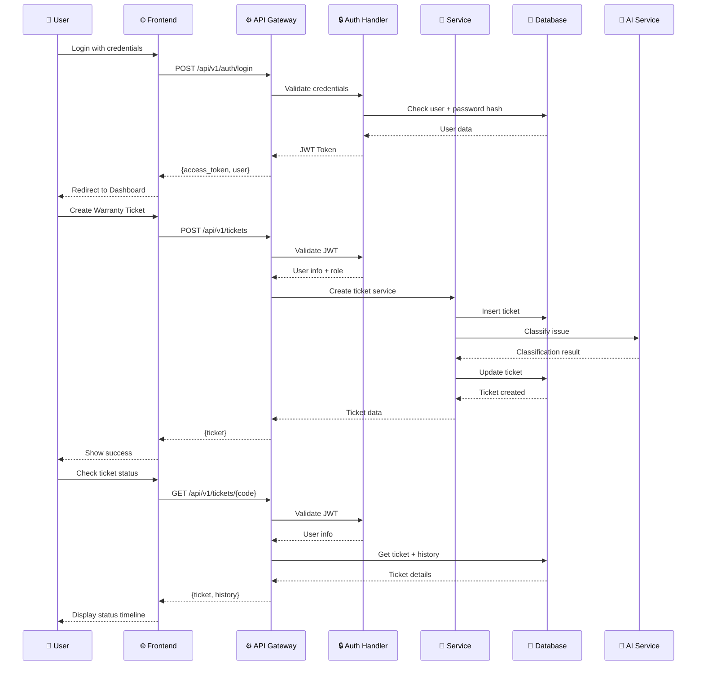
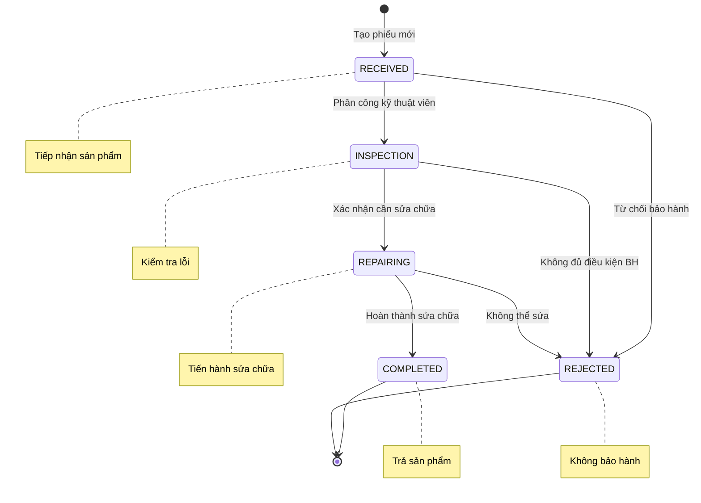
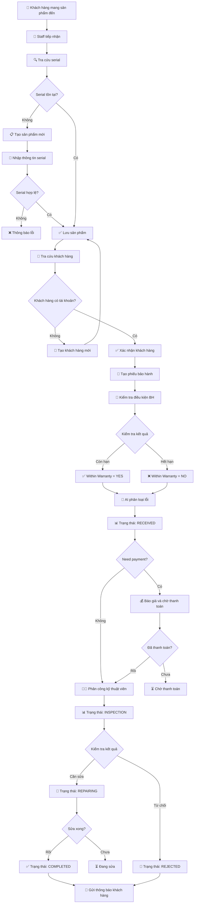
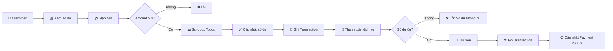
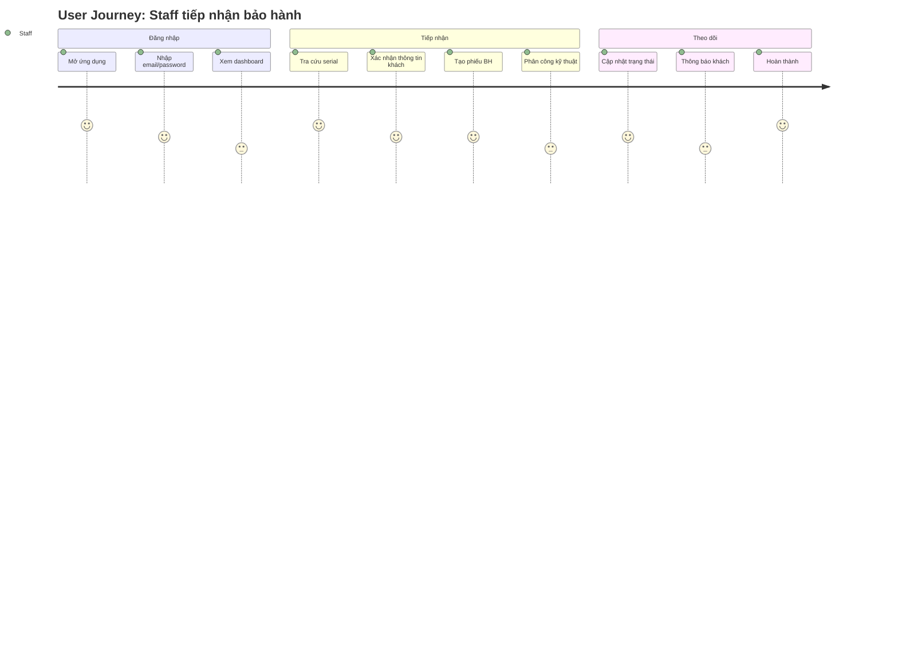
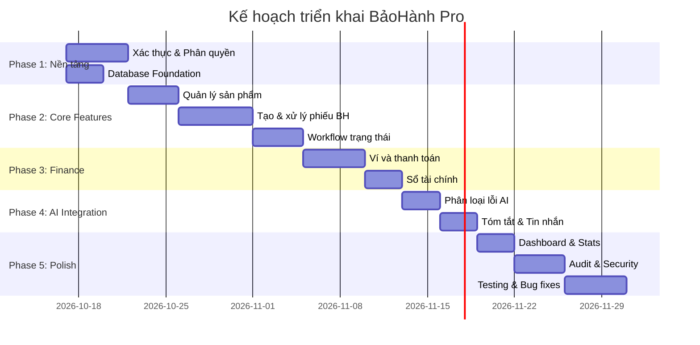

# ĐẶC TẢ VÀ KẾ HOẠCH CHI TIẾT
# HỆ THỐNG QUẢN LÝ BẢO HÀNH TÍCH HỢP AI — BẢOHÀNH PRO

> **Phiên bản:** v2.0
> **Ngày tạo:** 2026-10-17
> **Trạng thái:** Đang phát triển
> **Kiến trúc:** Single-tenant (sẵn sàng mở rộng Multi-tenant)

---

## MỤC LỤC

1. [Tổng quan dự án](#1-tổng-quan-dự-án)
2. [Kiến trúc hệ thống](#2-kiến-trúc-hệ-thống)
3. [Mô hình dữ liệu](#3-mô-hình-dữ-liệu)
4. [Danh sách User Stories](#4-danh-sách-user-stories)
5. [Luồng nghiệp vụ](#5-luồng-nghiệp-vụ)
6. [Danh sách API Endpoints](#6-danh-sách-api-endpoints)
7. [Quy trình phát triển](#7-quy-trình-phát-triển)
8. [Kế hoạch triển khai](#8-kế-hoạch-triển-khai)
9. [Ma trận vai trò](#9-ma-trận-vai-trò)
10. [Rủi ro và giải pháp](#10-rủi-ro-và-giải-pháp)

---

## 1. TỔNG QUAN DỰ ÁN

### 1.1 Bối cảnh

BảoHành Pro là hệ thống SaaS quản lý bảo hành sản phẩm tích hợp AI, được xây dựng để giải quyết các vấn đề:

- **Tiếp nhận bảo hành thủ công** — Quy trình giấy tờ, dễ thất lạc
- **Kiểm tra điều kiện bảo hành** — Phụ thuộc vào nhân viên, không nhất quán
- **Phân công kỹ thuật viên** — Thiếu minh bạch, khó theo dõi
- **Thông báo khách hàng** — Không tự động, mất thời gian
- **Tích hợp AI** — Phân loại lỗi, tóm tắt, sinh tin nhắn tự động

### 1.2 Mục tiêu

| Mục tiêu | Chỉ số thành công |
|-----------|-------------------|
| Giảm thời gian tiếp nhận bảo hành | 50% (từ 15 phút → 7 phút) |
| Tự động kiểm tra bảo hành | 100% phiếu được kiểm tra |
| Tăng minh bạch trong phân công | 100% phiếu có người phụ trách |
| Cải thiện trải nghiệm khách hàng | Phản hồi tự động trong 1 phút |
| Tích hợp AI hỗ trợ | Phân loại lỗi tự động |

### 1.3 Phạm vi

#### Trong phạm vi ✅
- Xác thực và phân quyền người dùng (4 vai trò)
- Quản lý sản phẩm và serial
- Quản lý khách hàng
- Tạo và xử lý phiếu bảo hành
- Workflow trạng thái phiếu tự động
- Tích hợp AI (phân loại, tóm tắt, tin nhắn)
- Ví và thanh toán dịch vụ ngoài bảo hành
- Sổ tài chính CPO
- Dashboard thống kê
- Tra cứu nhanh (Lookup)

#### Ngoài phạm vi ❌
- Multi-tenant (hiện tại single-tenant)
- Super-admin toàn nền tảng
- Tích hợp thanh toán thật (sandbox only)
- Mobile app
- Chatbot khách hàng

### 1.4 Đối tượng sử dụng

| Vai trò | Mô tả | Ví dụ |
|---------|-------|-------|
| `admin` | Quản trị viên tổ chức, quản lý thành viên, tài chính | Trưởng bộ phận bảo hành |
| `staff` | Nhân viên tiếp nhận, tạo phiếu, phân công | Lễ tân, nhân viên quầy |
| `technician` | Kỹ thuật viên, kiểm tra và sửa chữa | Kỹ thuật viên sửa chữa |
| `customer` | Khách hàng, xem sản phẩm và phiếu của mình | Người mua hàng |

### 1.5 Stack công nghệ

```
┌─────────────────────────────────────────────────────────────┐
│                         FRONTEND                             │
├─────────────────────────────────────────────────────────────┤
│  React 18 + Vite 5 + Tailwind 3.4 + Framer Motion 11      │
│  React Router 6 + Axios + Supabase JS 2.117               │
└─────────────────────────────────────────────────────────────┘
                              │
                              ▼
┌─────────────────────────────────────────────────────────────┐
│                         BACKEND                              │
├─────────────────────────────────────────────────────────────┤
│  Python 3.11 + FastAPI + SQLAlchemy + SQLite/PostgreSQL    │
│  Pydantic + JWT (python-jose) + Gemini AI                  │
└─────────────────────────────────────────────────────────────┘
                              │
                              ▼
┌─────────────────────────────────────────────────────────────┐
│                      DATA LAYER                              │
├─────────────────────────────────────────────────────────────┤
│  SQLite (dev/test) │ PostgreSQL (production)               │
│  Alembic migrations                                          │
└─────────────────────────────────────────────────────────────┘
```

---

## 2. KIẾN TRÚC HỆ THỐNG

### 2.1 Sơ đồ kiến trúc tổng quan



### 2.2 Cấu trúc thư mục

```
warranty-system/
├── backend/
│   ├── app/
│   │   ├── __init__.py
│   │   ├── main.py                 # FastAPI app entry
│   │   ├── api/
│   │   │   └── v1/
│   │   │       └── endpoints/       # API routes
│   │   │           ├── auth.py
│   │   │           ├── products.py
│   │   │           ├── tickets.py
│   │   │           ├── customers.py
│   │   │           ├── wallet.py
│   │   │           ├── ai.py
│   │   │           ├── finance.py
│   │   │           └── notifications.py
│   │   ├── core/
│   │   │   ├── config.py           # Environment config
│   │   │   ├── database.py         # SQLAlchemy setup
│   │   │   ├── security.py         # JWT & hashing
│   │   │   ├── permissions.py      # Role checking
│   │   │   └── response.py         # Response envelope
│   │   ├── models/                 # SQLAlchemy models
│   │   │   ├── user.py
│   │   │   ├── product.py
│   │   │   ├── warranty.py
│   │   │   ├── wallet.py
│   │   │   ├── finance.py
│   │   │   └── notification.py
│   │   ├── schemas/                # Pydantic schemas
│   │   │   └── schemas.py
│   │   ├── services/              # Business logic
│   │   │   ├── auth_service.py
│   │   │   ├── ticket_service.py
│   │   │   ├── wallet_service.py
│   │   │   └── ai_service.py
│   │   └── utils/
│   │       ├── datetime_utils.py
│   │       └── code_generator.py
│   ├── tests/                      # Pytest tests
│   ├── static/                     # Uploaded files
│   ├── .env                       # Environment secrets
│   └── requirements.txt
│
├── frontend/
│   ├── src/
│   │   ├── App.jsx                # Router setup
│   │   ├── main.jsx
│   │   ├── index.css
│   │   ├── pages/                 # Route pages
│   │   │   ├── Login.jsx
│   │   │   ├── Dashboard.jsx
│   │   │   ├── Tickets.jsx
│   │   │   ├── TicketDetail.jsx
│   │   │   ├── Products.jsx
│   │   │   ├── Customers.jsx
│   │   │   ├── AIConsole.jsx
│   │   │   ├── Payment.jsx
│   │   │   ├── Wallet.jsx
│   │   │   ├── Settings.jsx
│   │   │   └── Lookup.jsx
│   │   ├── components/            # Reusable components
│   │   │   ├── Layout.jsx
│   │   │   ├── Sidebar.jsx
│   │   │   ├── Header.jsx
│   │   │   ├── ProtectedRoute.jsx
│   │   │   ├── RegisterModal.jsx
│   │   │   ├── LookupModal.jsx
│   │   │   ├── CreateTicket/
│   │   │   └── dashboard/
│   │   ├── context/               # React contexts
│   │   │   ├── AuthContext.jsx
│   │   │   └── NotificationContext.jsx
│   │   ├── hooks/                 # Custom hooks
│   │   │   └── useDebounce.js
│   │   ├── services/              # API clients
│   │   │   ├── api.js
│   │   │   └── supabase.js
│   │   ├── validators/            # Form validators
│   │   │   └── registerValidators.js
│   │   └── config/                # App config
│   │       └── statusConfig.js
│   ├── public/
│   └── package.json
│
└── docs/                          # Documentation
    ├── SPEC.md                    # This file
    ├── USER_STORIES.md
    ├── OPEN_QUESTIONS.md
    ├── SECURITY_ROADMAP.md
    ├── UX_AUDIT.md
    └── Work.md
```

### 2.3 Luồng request



---

## 3. MÔ HÌNH DỮ LIỆU

### 3.1 ERD - Entity Relationship Diagram

```mermaid
erDiagram
    USERS ||--o{ PRODUCTS : "owns"
    USERS ||--o{ WARRANTY_TICKETS : "creates"
    USERS ||--o{ WARRANTY_TICKETS : "assigned_to"
    USERS ||--|| WALLETS : "has"
    USERS ||--o{ TRANSACTIONS : "initiates"
    USERS ||--o{ NOTIFICATIONS : "receives"
    
    PRODUCTS ||--o{ WARRANTY_TICKETS : "generates"
    
    WARRANTY_TICKETS ||--o{ WARRANTY_HISTORY : "has"
    WARRANTY_TICKETS ||--o| TRANSACTIONS : "paid_by"
    
    WALLETS ||--o{ TRANSACTIONS : "contains"
    
    FINANCE_TRANSACTIONS {
        int id PK
        string txn_code UK
        string date
        string description
        decimal amount
        string type
        string category
        string reference
        string created_at
    }

    USERS {
        int id PK
        string email UK
        string full_name
        string phone
        string hashed_password
        string role
        bool is_active
        string avatar_url
        bool is_seed
        datetime created_at
    }

    PRODUCTS {
        int id PK
        string name
        string serial_number UK
        string category
        int warranty_months
        date manufacture_date
        int customer_id FK
        decimal price
        text description
    }

    WARRANTY_TICKETS {
        int id PK
        string ticket_code UK
        int product_id FK
        int customer_id FK
        int technician_id FK
        text issue_description
        string status
        string ai_classification
        text ai_summary
        text ai_progress_message
        string within_warranty
        string warranty_check_reason
        decimal repair_cost
        string payment_status
        datetime created_at
        datetime updated_at
    }

    WARRANTY_HISTORY {
        int id PK
        int ticket_id FK
        int technician_id FK
        text action_note
        string status_from
        string status_to
        datetime created_at
    }

    WALLETS {
        int id PK
        int user_id FK UK
        decimal balance
    }

    TRANSACTIONS {
        int id PK
        int wallet_id FK
        string type
        decimal amount
        decimal balance_after
        string reference
        string created_at
    }

    NOTIFICATIONS {
        int id PK
        int user_id FK
        string title
        text message
        bool is_read
        datetime created_at
    }
```

### 3.2 Bảng chi tiết

#### Users
| Trường | Kiểu | Ràng buộc | Mô tả |
|--------|------|----------|-------|
| id | INT | PK, AUTO | ID người dùng |
| email | VARCHAR | UNIQUE, NOT NULL | Email đăng nhập |
| full_name | VARCHAR | NOT NULL | Họ tên đầy đủ |
| phone | VARCHAR | NULLABLE | Số điện thoại |
| hashed_password | VARCHAR | NOT NULL | Băm mật khẩu (bcrypt) |
| role | VARCHAR | NOT NULL, DEFAULT 'customer' | Vai trò: admin, staff, technician, customer |
| is_active | BOOLEAN | DEFAULT TRUE | Tài khoản có hoạt động không |
| avatar_url | VARCHAR | NULLABLE | URL avatar |
| is_seed | BOOLEAN | NOT NULL | Tạo từ seed data |
| created_at | DATETIME | AUTO | Thời điểm tạo |

#### Products
| Trường | Kiểu | Ràng buộc | Mô tả |
|--------|------|----------|-------|
| id | INT | PK, AUTO | ID sản phẩm |
| name | VARCHAR | NOT NULL | Tên sản phẩm |
| serial_number | VARCHAR | UNIQUE, NOT NULL, INDEX | Số serial |
| category | VARCHAR | NOT NULL | Loại: Router, Camera, Switch... |
| warranty_months | INT | NOT NULL, DEFAULT 12 | Thời hạn bảo hành (tháng) |
| manufacture_date | DATE | NOT NULL | Ngày sản xuất |
| customer_id | INT | FK → users.id | Chủ sở hữu |
| price | DECIMAL(12,2) | NULLABLE | Giá sản phẩm |
| description | TEXT | NULLABLE | Mô tả sản phẩm |

#### Warranty_Tickets
| Trường | Kiểu | Ràng buộc | Mô tả |
|--------|------|----------|-------|
| id | INT | PK, AUTO | ID phiếu |
| ticket_code | VARCHAR | UNIQUE, INDEX | Mã phiếu: WR-2026-001 |
| product_id | INT | FK → products.id | Sản phẩm bảo hành |
| customer_id | INT | FK → users.id | Khách hàng tạo |
| technician_id | INT | FK → users.id | Kỹ thuật viên phụ trách |
| issue_description | TEXT | NOT NULL | Mô tả lỗi |
| status | VARCHAR | NOT NULL, DEFAULT 'RECEIVED' | Trạng thái |
| ai_classification | VARCHAR | NULLABLE | Phân loại AI |
| ai_summary | TEXT | NULLABLE | Tóm tắt AI |
| ai_progress_message | TEXT | NULLABLE | Tin nhắn tiến độ |
| within_warranty | VARCHAR | NULLABLE | YES/NO |
| warranty_check_reason | VARCHAR | NULLABLE | Lý do kiểm tra |
| repair_cost | DECIMAL(14,2) | DEFAULT 0 | Chi phí sửa chữa |
| payment_status | VARCHAR | NOT NULL, DEFAULT 'UNPAID' | UNPAID/PAID/WAIVED |
| created_at | DATETIME | AUTO | Ngày tạo |
| updated_at | DATETIME | AUTO | Ngày cập nhật |

#### Warranty_History
| Trường | Kiểu | Ràng buộc | Mô tả |
|--------|------|----------|-------|
| id | INT | PK, AUTO | ID |
| ticket_id | INT | FK → warranty_tickets.id | Phiếu liên quan |
| technician_id | INT | FK → users.id | Người thực hiện |
| action_note | TEXT | NOT NULL | Ghi chú hành động |
| status_from | VARCHAR | NULLABLE | Trạng thái trước |
| status_to | VARCHAR | NOT NULL | Trạng thái sau |
| created_at | DATETIME | AUTO | Thời điểm |

#### Wallets
| Trường | Kiểu | Ràng buộc | Mô tả |
|--------|------|----------|-------|
| id | INT | PK, AUTO | ID ví |
| user_id | INT | FK → users.id, UNIQUE | Chủ ví |
| balance | DECIMAL(14,2) | NOT NULL, DEFAULT 0 | Số dư (VND) |

#### Transactions
| Trường | Kiểu | Ràng buộc | Mô tả |
|--------|------|----------|-------|
| id | INT | PK, AUTO | ID |
| wallet_id | INT | FK → wallets.id | Ví liên quan |
| type | VARCHAR | NOT NULL | TOPUP/PAYMENT_WARRANTY/REFUND |
| amount | DECIMAL(14,2) | NOT NULL | Số tiền |
| balance_after | DECIMAL(14,2) | NOT NULL | Số dư sau giao dịch |
| reference | VARCHAR | NULLABLE | Tham chiếu (ticket_code) |
| created_at | VARCHAR | NOT NULL | ISO timestamp |

### 3.3 Workflow trạng thái



---

## 4. DANH SÁCH USER STORIES

### US-01: Xác thực và phân quyền (P0)

**Với tư cách** người dùng chưa đăng nhập,
**tôi muốn** đăng ký và đăng nhập để nhận JWT token,
**để** truy cập các chức năng theo vai trò của mình.

**Tiêu chí chấp nhận:**
- ✅ Đăng ký trả HTTP 201 + thông tin user (không có password hash)
- ✅ Đăng nhập trả HTTP 200 + JWT Bearer
- ✅ Sai mật khẩu trả HTTP 401 (thông báo chung)
- ✅ Token hết hạn/sai → từ chối truy cập
- ✅ Rate limit cho login/register
- ✅ Role mặc định = `customer` khi đăng ký

### US-02: Quản lý sản phẩm (P1)

**Với tư cách** staff hoặc admin,
**tôi muốn** tạo, xem, sửa sản phẩm và tra cứu theo serial,
**để** lưu thông tin và tra cứu khi khách mang hàng đến.

**Tiêu chí chấp nhận:**
- ✅ Serial unique → HTTP 201; trùng → HTTP 409
- ✅ Tra cứu serial → trả thông tin sản phẩm + khách hàng
- ✅ Người dùng chỉ thao tác trong phạm vi quyền

### US-03: Tạo phiếu bảo hành (P1)

**Với tư cách** staff,
**tôi muốn** tạo phiếu từ serial + mô tả lỗi,
**để** hệ thống tự kiểm tra còn/hết bảo hành.

**Tiêu chí chấp nhận:**
- ✅ Tạo phiếu → trạng thái RECEIVED + kết quả kiểm tra BH
- ✅ AI phân loại lỗi tự động
- ✅ Không tạo phiếu cho sản phẩm không thuộc khách hàng

### US-04: Phân công kỹ thuật viên (P1)

**Với tư cách** staff hoặc admin,
**tôi muốn** chọn kỹ thuật viên và gán vào phiếu,
**để** phiếu được chuyển sang INSPECTION.

**Tiêu chí chấp nhận:**
- ✅ Phân công → RECEIVED → INSPECTION
- ✅ Chỉ admin/staff mới phân công được
- ✅ Ghi lịch sử phân công

### US-05: Workflow trạng thái phiếu (P1)

**Với tư cách** technician,
**tôi muốn** cập nhật trạng thái phiếu,
**để** khách hàng theo dõi tiến độ.

**Tiêu chí chấp nhận:**
- ✅ Chuyển hợp lệ → HTTP 200 + ghi history
- ✅ Chuyển không hợp lệ → HTTP 400
- ✅ Ghi actor_id, timestamp, status cũ/mới

### US-06: AI phân loại lỗi (P2)

**Với tư cách** staff,
**tôi muốn** mô tả lỗi được AI phân loại tự động,
**để** tiết kiệm thời gian phân loại thủ công.

**Tiêu chí chấp nhận:**
- ✅ 5 categories: HARDWARE, SOFTWARE, NETWORK, PHYSICAL, POWER
- ✅ Fallback → OTHER + đánh dấu FALLBACK/MOCK
- ✅ AI không quyết định quyền bảo hành

### US-07: AI tóm tắt lịch sử (P2)

**Với tư cách** technician,
**tôi muốn** nhận bản tóm tắt lịch sử phiếu,
**để** nắm nhanh bối cảnh trước khi sửa.

**Tiêu chí chấp nhận:**
- ✅ Tóm tắt 3-5 dòng
- ✅ Anonymizer ẩn SĐT, email, CCCD
- ✅ Không ghi đè bản tóm tắt hợp lệ bằng lỗi

### US-08: AI tin nhắn tiến độ (P2)

**Với tư cách** customer,
**tôi muốn** nhận tin nhắn thông báo sau mỗi chuyển trạng thái,
**để** biết phiếu đang ở giai đoạn nào.

**Tiêu chí chấp nhận:**
- ✅ 5 mẫu tin theo 5 trạng thái
- ✅ Tin nhắn ẩn danh
- ✅ Fallback mẫu an toàn khi AI lỗi

### US-09: Ví và thanh toán (P1)

**Với tư cách** customer,
**tôi muốn** xem số dư, nạp tiền và thanh toán dịch vụ,
**để** trả phí sửa chữa không dùng tiền mặt.

**Tiêu chí chấp nhận:**
- ✅ Topup → số dư tăng + ghi history
- ✅ Thanh toán → số dư giảm + ghi history
- ✅ Vượt số dư → lỗi "Số dư không đủ"
- ✅ Chống race condition (idempotency)

### US-10: Dashboard thống kê (P1)

**Với tư cách** staff hoặc admin,
**tôi muốn** xem dashboard với tổng phiếu, theo trạng thái, top lỗi,
**để** đánh giá hiệu suất.

**Tiêu chí chấp nhận:**
- ✅ Tổng phiếu, theo trạng thái, top 5 lỗi
- ✅ Tỷ lệ từ chối, thời gian xử lý TB
- ✅ Giới hạn theo quyền

### US-11: Sổ tài chính CPO (P1)

**Với tư cách** admin,
**tôi muốn** xem danh sách thu chi với bộ lọc,
**để** theo dõi dòng tiền.

**Tiêu chí chấp nhận:**
- ✅ Lọc theo ngày, danh mục, loại
- ✅ Tổng thu/chi trên toàn tập
- ✅ Chỉ vai trò có quyền tài chính

---

## 5. LUỒNG NGHIỆP VỤ

### 5.1 Luồng tạo phiếu bảo hành



### 5.2 Luồng thanh toán ví



### 5.3 User Journey - Staff tiếp nhận



---

## 6. DANH SÁCH API ENDPOINTS

### 6.1 Authentication

| Method | Endpoint | Mô tả | Role |
|--------|----------|--------|------|
| POST | `/api/v1/auth/register` | Đăng ký tài khoản | Public |
| POST | `/api/v1/auth/login` | Đăng nhập | Public |
| POST | `/api/v1/auth/reset-code` | Yêu cầu mã đặt lại MK | Public |
| POST | `/api/v1/auth/reset-password` | Đặt lại mật khẩu | Public |
| GET | `/api/v1/auth/me` | Lấy thông tin user hiện tại | All |
| POST | `/api/v1/auth/change-password` | Đổi mật khẩu | All |
| POST | `/api/v1/auth/users` | Tạo user (admin) | Admin |
| GET | `/api/v1/auth/users` | Danh sách users | Admin, Staff |

### 6.2 Products

| Method | Endpoint | Mô tả | Role |
|--------|----------|--------|------|
| GET | `/api/v1/products` | Danh sách sản phẩm | Admin, Staff |
| POST | `/api/v1/products` | Tạo sản phẩm | Admin, Staff |
| GET | `/api/v1/products/{id}` | Chi tiết sản phẩm | Admin, Staff, Customer |
| PUT | `/api/v1/products/{id}` | Cập nhật sản phẩm | Admin, Staff |
| GET | `/api/v1/products/serial/{serial}` | Tra cứu theo serial | All |

### 6.3 Tickets

| Method | Endpoint | Mô tả | Role |
|--------|----------|--------|------|
| GET | `/api/v1/tickets` | Danh sách phiếu | Staff, Admin |
| POST | `/api/v1/tickets` | Tạo phiếu mới | Staff, Admin |
| GET | `/api/v1/tickets/{id}` | Chi tiết phiếu | Staff, Admin, Customer (own) |
| POST | `/api/v1/tickets/{id}/assign` | Phân công kỹ thuật | Staff, Admin |
| POST | `/api/v1/tickets/{id}/status` | Cập nhật trạng thái | Staff, Admin, Technician (assigned) |
| POST | `/api/v1/tickets/{id}/pay` | Thanh toán | Customer (own) |
| GET | `/api/v1/tickets/stats/summary` | Thống kê dashboard | Staff, Admin |
| GET | `/api/v1/tickets/public/{code}` | Tra cứu công khai | Public |

### 6.4 Customers

| Method | Endpoint | Mô tả | Role |
|--------|----------|--------|------|
| GET | `/api/v1/customers` | Danh sách khách hàng | Admin, Staff |
| GET | `/api/v1/customers/{id}` | Chi tiết khách hàng | Admin, Staff |
| GET | `/api/v1/customers/technicians` | Danh sách kỹ thuật viên | Staff, Admin |

### 6.5 Wallet

| Method | Endpoint | Mô tả | Role |
|--------|----------|--------|------|
| GET | `/api/v1/wallet/me` | Lấy thông tin ví | Customer |
| POST | `/api/v1/wallet/topup` | Nạp tiền | Customer |
| GET | `/api/v1/wallet/transactions` | Lịch sử giao dịch | Customer |

### 6.6 AI

| Method | Endpoint | Mô tả | Role |
|--------|----------|--------|------|
| POST | `/api/v1/ai/classify` | Phân loại lỗi | Staff, Admin |
| POST | `/api/v1/ai/summarize/{ticket_id}` | Tóm tắt lịch sử | Staff, Admin, Technician |
| POST | `/api/v1/ai/progress-message` | Sinh tin nhắn tiến độ | Staff, Admin |

### 6.7 Finance

| Method | Endpoint | Mô tả | Role |
|--------|----------|--------|------|
| GET | `/api/v1/finance/transactions` | Danh sách giao dịch | Admin |
| GET | `/api/v1/finance/summary` | Tổng hợp thu chi | Admin |

### 6.8 Notifications

| Method | Endpoint | Mô tả | Role |
|--------|----------|--------|------|
| GET | `/api/v1/notifications` | Danh sách thông báo | All |
| PUT | `/api/v1/notifications/{id}/read` | Đánh dấu đã đọc | All |

---

## 7. QUY TRÌNH PHÁT TRIỂN

### 7.1 AI Agent Workflow với Cổng Kiểm Soát

```mermaid
flowchart TB
    subgraph Phase0["📋 PHASE 0: DISCOVERY"]
        D1[Khảo sát source code]
        D2[Cấu trúc dự án]
        D3[Framework, Database]
        D4[Tạo báo cáo hiện trạng]
    end
    
    subgraph Phase1["📝 PHASE 1: REQUIREMENTS"]
        R1[Lập User Story]
        R2[Acceptance Criteria]
        R3[Business Rules]
        R4[Câu hỏi chưa giải đáp]
    end
    
    subgraph Phase2["🎨 PHASE 2: DESIGN"]
        T1[Thiết kế dữ liệu]
        T2[API Contract]
        T3[Luồng UI]
        T4[Phương án kiểm thử]
    end
    
    subgraph Phase3["📊 PHASE 3: PLAN"]
        P1[Chia task nhỏ]
        P2[Khai báo phụ thuộc]
        P3[Danh sách file thay đổi]
        P4[Đánh giá rủi ro]
    end
    
    subgraph Phase4["💻 PHASE 4: IMPLEMENT"]
        I1[Code theo task]
        I2[Tuân thủ coding standards]
        I3[Không mở rộng phạm vi]
    end
    
    subgraph Phase5["✅ PHASE 5: VERIFY"]
        V1[Chạy pytest]
        V2[Lint, Type-check]
        V3[Security check]
        V4[Build verification]
    end
    
    subgraph Phase6["🔍 PHASE 6: REVIEW"]
        RV1[So sánh diff]
        RV2[Kiểm tra regression]
        RV3[Đánh giá migration]
    end
    
    subgraph Phase7["📚 PHASE 7: DOCUMENT"]
        DOC1[Cập nhật tài liệu]
        DOC2[Changelog]
        DOC3[Sơ đồ mới]
    end
    
    subgraph Phase8["🎯 PHASE 8: ACCEPTANCE"]
        A1[Đối chiếu từng AC]
        A2[Lưu bằng chứng]
    end
    
    Phase0 --> Phase1
    Phase1 --> Phase2
    Phase2 --> Phase3
    Phase3 --> Phase4
    Phase4 --> Phase5
    Phase5 --> Phase6
    Phase6 --> Phase7
    Phase7 --> Phase8
    
    Phase1 -->|Cổng: Xác nhận YC| Phase2
    Phase2 -->|Cổng: Duyệt thiết kế| Phase3
    Phase3 -->|Cổng: Phê duyệt plan| Phase4
    Phase4 -->|Cổng: Review code| Phase5
```



### 7.2 Cổng bắt buộc

| Cổng | Điều kiện | Hành động nếu fail |
|------|----------|-------------------|
| Xác nhận YC | User Story đã duyệt | Dừng, báo cáo |
| Duyệt thiết kế | ERD, API contract OK | Không code lớn |
| Phê duyệt plan | Task list + risk assessment | Review lại |
| Review code | Diff trong phạm vi | Sửa lại |

### 7.3 Coding Standards

```python
# ✅ ĐÚNG
def create_ticket(product_id: int, customer_id: int, description: str):
    """Tạo phiếu bảo hành mới.
    
    Args:
        product_id: ID sản phẩm
        customer_id: ID khách hàng
        description: Mô tả lỗi
        
    Returns:
        WarrantyTicket: Phiếu đã tạo
        
    Raises:
        ProductNotFoundError: Sản phẩm không tồn tại
        CustomerNotFoundError: Khách hàng không tồn tại
    """
    product = get_product_or_404(product_id)
    # ... logic
```

```javascript
// ✅ ĐÚNG - React component
export function TicketCard({ ticket, onClick }) {
  const statusColor = useMemo(
    () => STATUS_COLORS[ticket.status] ?? 'gray',
    [ticket.status]
  )
  
  return (
    <div className="ticket-card" onClick={onClick}>
      <StatusBadge status={ticket.status} />
      {/* ... */}
    </div>
  )
}

// ❌ SAI - Không mutate state
// tickets.push(newTicket)  // Không làm thế này
// setTickets([...tickets, newTicket])  // Đúng
```

### 7.4 Definition of Done

| Tiêu chí | Yêu cầu |
|---------|---------|
| Code | Chạy được, không có lỗi lint |
| Test | Unit test pass, coverage > 70% |
| Security | Không có lỗi P0/P1 |
| Documentation | Cập nhật tài liệu liên quan |
| Review | Đã review bởi người khác |

---

## 8. KẾ HOẠCH TRIỂN KHAI

### 8.1 Backlog theo độ ưu tiên

| ID | Epic | User Story | Độ khó | Ưu tiên | Phụ thuộc |
|----|------|-----------|--------|---------|-----------|
| E01 | Nền tảng | US-01 Xác thực | Lớn | P0 | - |
| E02 | Nền tảng | US-12 Quản lý tổ chức | Lớn | P0 | E01 |
| E03 | Sản phẩm | US-02 Quản lý SP | Trung bình | P1 | E01 |
| E04 | Phiếu BH | US-03 Tạo phiếu | Trung bình | P1 | E03 |
| E05 | Phiếu BH | US-04 Phân công | Nhỏ | P1 | E04 |
| E06 | Phiếu BH | US-05 Workflow | Trung bình | P1 | E05 |
| E07 | Tài chính | US-09 Ví | Trung bình | P1 | E01 |
| E08 | Tài chính | US-11 Sổ tài chính | Trung bình | P1 | E07 |
| E09 | AI | US-06 Phân loại lỗi | Trung bình | P2 | E04 |
| E10 | AI | US-07 Tóm tắt | Nhỏ | P2 | E06 |
| E11 | AI | US-08 Tin nhắn tiến độ | Nhỏ | P2 | E06 |
| E12 | Dashboard | US-10 Dashboard | Trung bình | P1 | E04 |
| E13 | Thông báo | US-14 Quản lý TB | Nhỏ | P1 | E06 |
| E14 | Audit | US-16 Audit log | Trung bình | P1 | E01 |
| E15 | Tài liệu | US-15 Tệp đính kèm | Nhỏ | P2 | E06 |
| E16 | Vật tư | US-17 Linh kiện | Lớn | P2 | E06, E08 |

### 8.2 Lộ trình triển khai



### 8.3 Sprint Planning

#### Sprint 1 (Week 1-2): Authentication & Foundation
- US-01: Login/Register/Logout
- Database schema review
- Security middleware setup
- Unit tests for auth

#### Sprint 2 (Week 3-4): Product Management
- US-02: CRUD Products
- Serial lookup
- Customer management
- US-03: Ticket creation

#### Sprint 3 (Week 5-6): Ticket Workflow
- US-04: Assign technician
- US-05: Status workflow
- History tracking
- Notifications

#### Sprint 4 (Week 7-8): Finance
- US-09: Wallet operations
- US-11: Finance ledger
- Payment integration

#### Sprint 5 (Week 9-10): AI Features
- US-06: AI classification
- US-07: AI summarize
- US-08: Progress messages

#### Sprint 6 (Week 11-12): Polish & Launch
- US-10: Dashboard
- US-16: Audit log
- Performance optimization
- Bug fixes & testing

---

## 9. MA TRẬN VAI TRÒ

| Tính năng | customer | staff | technician | admin |
|-----------|----------|-------|------------|-------|
| Đăng nhập/Đăng ký | ✅ | ✅ | ✅ | ✅ |
| Xem sản phẩm của mình | ✅ | ✅ | ✅ | ✅ |
| CRUD sản phẩm | ❌ | ✅ | ❌ | ✅ |
| Tạo phiếu BH | ❌ | ✅ | ❌ | ✅ |
| Phân công kỹ thuật | ❌ | ✅ | ❌ | ✅ |
| Cập nhật trạng thái | ❌ | ✅ | ✅ (assigned) | ✅ |
| Xem phiếu của mình | ✅ | ✅ | ✅ | ✅ |
| Ví cá nhân | ✅ | ❌ | ❌ | ❌ |
| Dashboard tổ chức | ❌ | ✅ | ✅ | ✅ |
| Sổ tài chính | ❌ | ❌ | ❌ | ✅ |
| Quản lý thành viên | ❌ | ❌ | ❌ | ✅ |
| AI phân loại | Tự động | Tự động | ❌ | ✅ |
| Audit log | ❌ | ❌ | ❌ | ✅ |

---

## 10. RỦI RO VÀ GIẢI PHÁP

### 10.1 Ma trận rủi ro

| ID | Rủi ro | Khả năng | Tác động | Mức độ | Giải pháp |
|----|--------|----------|----------|--------|-----------|
| R01 | Token hết hạn trong session dài | Cao | Thấp | 🟡 | Auto-refresh token |
| R02 | Race condition thanh toán | Thấp | Cao | 🟠 | Idempotency key |
| R03 | AI service unavailable | Trung bình | Thấp | 🟡 | Mock fallback |
| R04 | Serial trùng lặp | Thấp | Trung bình | 🟡 | Unique constraint + validation |
| R05 | Data breach | Rất thấp | Rất cao | 🔴 | Encryption, audit log |
| R06 | Migration fail | Thấp | Cao | 🟠 | Backup + rollback plan |
| R07 | Performance degradation | Trung bình | Trung bình | 🟡 | Indexing, caching |
| R08 | CSRF attack | Thấp | Cao | 🟠 | CSRF token |

### 10.2 Giải pháp chi tiết

#### R02: Race Condition thanh toán

```python
# Backend: Sử dụng idempotency key
class WalletService:
    def pay(self, wallet_id: int, amount: Decimal, 
            ticket_id: int, idempotency_key: str):
        # Kiểm tra idempotency key đã tồn tại
        existing = self.db.query(Transaction).filter(
            Transaction.idempotency_key == idempotency_key
        ).first()
        
        if existing:
            return existing  # Trả về transaction cũ
        
        # Lock row để tránh race
        wallet = self.db.query(Wallet).filter(
            Wallet.id == wallet_id
        ).with_for_update().first()
        
        if wallet.balance < amount:
            raise InsufficientBalanceError()
        
        # Thực hiện thanh toán
        # ...
```

#### R05: Data Protection

```python
# Middleware bảo vệ dữ liệu
class DataProtectionMiddleware:
    async def __call__(self, request, call_next):
        response = await call_next(request)
        
        # Strip sensitive fields
        if hasattr(response, 'body'):
            body = json.loads(response.body)
            body = self._redact_sensitive(body)
            response.body = json.dumps(body).encode()
        
        return response
    
    def _redact_sensitive(self, data):
        sensitive_fields = ['password', 'hashed_password', 
                           'token', 'secret', 'api_key']
        # Redact logic...
```

---

## PHỤ LỤC

### A. Bảng truy vết Requirements → Implementation

| Req ID | Mô tả | US ID | Module | DB Entity | Test |
|--------|-------|-------|--------|-----------|------|
| REQ-001 | JWT authentication | US-01 | auth.py | users | test_auth |
| REQ-002 | Role-based access | US-01 | permissions.py | users | test_rbac |
| REQ-003 | Product CRUD | US-02 | products.py | products | test_products |
| REQ-004 | Ticket workflow | US-03,05 | tickets.py | warranty_tickets | test_tickets |
| REQ-005 | Wallet operations | US-09 | wallet.py | wallets, transactions | test_wallet |
| REQ-006 | AI integration | US-06,07,08 | ai_service.py | warranty_tickets | test_ai |

### B. Môi trường Development

```bash
# Backend
cd warranty-system/backend
python -m venv venv
source venv/bin/activate  # Windows: venv\Scripts\activate
pip install -r requirements.txt
cp .env.example .env
# Edit .env with your secrets
uvicorn app.main:app --reload

# Frontend
cd warranty-system/frontend
npm install
npm run dev

# Run tests
cd warranty-system/backend
python -m pytest tests/

# Frontend tests
cd warranty-system/frontend
npm test
```

### C. Environment Variables

```bash
# Backend .env
SECRET_KEY=your-secret-key-here
DATABASE_URL=sqlite:///./warranty.db
BACKEND_CORS_ORIGINS=["http://localhost:5173"]
GEMINI_API_KEY=your-gemini-key  # Optional
AI_MODE=mock  # mock | gemini
ALLOW_SANDBOX_TOPUP=true

# Frontend .env
VITE_API_URL=http://localhost:8000
VITE_SUPABASE_URL=  # Optional for Google Auth
VITE_SUPABASE_ANON_KEY=  # Optional
```

---

**Document Status:** Draft → Review → Approved
**Last Updated:** 2026-10-17
**Next Review:** 2026-10-24
