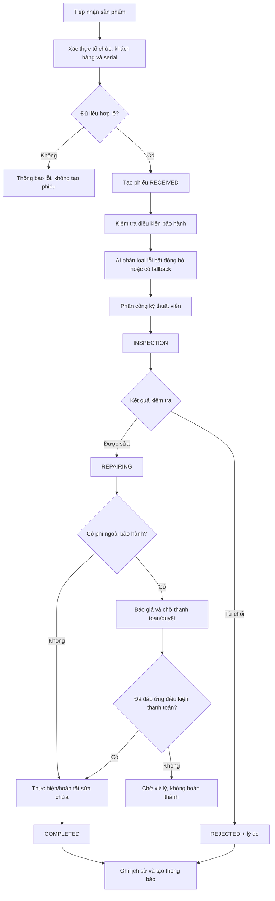

# USER STORIES — Hệ thống Quản lý Bảo hành tích hợp AI

> Phiên bản: **v1.0** — Cập nhật 2026-10-03.
> Phạm vi: 11 user story ban đầu (US-01 → US-11) + 6 story bổ sung đề xuất (US-12 → US-17).
> Format: **Với tư cách [vai trò] / Tôi muốn [hành động] / Để [mục tiêu]**.
> Ngôn ngữ: Tiếng Việt, định danh kỹ thuật giữ tiếng Anh.
> Ưu tiên: **P0** (an toàn nền tảng) · **P1** (nghiệp vụ cốt lõi) · **P2** (mở rộng).

---

## Tóm tắt thay đổi so với v0.1

1. Sửa lỗi định dạng: thay "30 số 201" / "30 số 200" / "30 số 401" bằng `HTTP 201` / `HTTP 200` / `HTTP 401`.
2. Bổ sung tiêu chí `organization_id` (multi-tenant) cho mọi story có truy cập dữ liệu.
3. Chốt bảng chuyển trạng thái US-05 (RECEIVED → INSPECTION → REPAIRING → COMPLETED, có luật REJECTED và COMPLETED).
4. Bổ sung 6 story mới (US-12 → US-17) để bao phủ vòng đời vận hành thực tế.
5. US-03 đánh dấu `[CẦN XÁC NHẬN NGHIỆP VỤ]` cho quy tắc tính hạn bảo hành.
6. Chuẩn hóa ma trận role × tính năng, thêm ghi chú rõ `admin` = admin tổ chức (không phải super-admin).

---

## US-01 · P0 · Xác thực và phân quyền

**Với tư cách** là người dùng chưa đăng nhập,
**tôi muốn** đăng ký tài khoản mới qua `POST /api/v1/auth/register` và đăng nhập qua `POST /api/v1/auth/login` để nhận JWT Bearer 24 giờ,
**để** truy cập đúng các chức năng theo vai trò của mình.

**Tiêu chí chấp nhận (sửa lỗi):**

- Đăng ký hợp lệ trả `HTTP 201` + thông tin user (không bao gồm password hash).
- Đăng nhập thành công trả `HTTP 200` + JWT Bearer.
- Sai mật khẩu trả `HTTP 401` với thông báo chung (không tiết lộ email tồn tại).
- Token hết hạn, sai chữ ký hoặc không hợp lệ bị từ chối.
- Endpoint bảo vệ bằng `@require_roles` chặn truy cập sai vai trò (`HTTP 403`).
- Tài khoản bị khóa hoặc thành viên bị thu hồi quyền không thể tiếp tục hành động.
- Có kiểm soát tốc độ (rate limit) cho `/auth/login` và `/auth/register`.
- Response không lộ password hash, token nội bộ, hoặc thông tin xác thực.

**Quy tắc nghiệp vụ (sửa lỗi S1):**

- **Server tự gán role mặc định = `customer` cho đăng ký công khai.** Không chấp nhận role gửi từ client.
- Endpoint tạo / thay đổi role đặc quyền (`admin`, `staff`, `technician`) yêu cầu người gọi có quyền tương ứng và được kiểm tra ở backend.
- Vai trò trong hệ thống: `admin` (admin tổ chức), `staff`, `technician`, `customer`.
- Nếu hệ thống có `super-admin` (toàn nền tảng), đặc tả riêng — không nằm trong US-01.

**Đề xuất bổ sung:** quên mật khẩu (đã có `request-reset-code`, `reset-password`), xác minh email, đổi mật khẩu (`change-password`), đăng xuất/thu hồi phiên, quy trình khóa tài khoản.

---

## US-02 · P1 · Quản lý sản phẩm và serial

**Với tư cách** là nhân viên tiếp nhận (`staff`) hoặc quản trị viên (`admin`),
**tôi muốn** tạo, xem, sửa, xóa sản phẩm và tra cứu nhanh theo serial qua `GET /api/v1/products/serial/{serial}`,
**để** lưu thông tin sản phẩm và tra cứu ngay khi khách mang hàng đến.

**Tiêu chí chấp nhận (bổ sung):**

- Tạo sản phẩm thành công nếu serial chưa tồn tại → `HTTP 201`.
- Trùng serial → `HTTP 409 Conflict` (sửa từ `400`) với mã lỗi ổn định.
- Tra cứu theo serial trả về trong điều kiện benchmark đã ghi nhận (xem Ghi chú hiệu năng).
- **Phạm vi duy nhất của serial:** cần xác nhận (toàn hệ thống hay theo tổ chức). Hiện đang là unique theo DB — ghi `[CẦN XÁC NHẬN]`.
- Serial chuẩn hóa thống nhất (trim, chữ hoa/thường theo chính sách).
- Unique constraint bảo vệ ở database, không chỉ kiểm tra trước khi insert.
- Người dùng chỉ thao tác sản phẩm thuộc tổ chức và phạm vi quyền của mình.
- Sản phẩm đã được dùng trong phiếu bảo hành: **không xóa cứng** — ưu tiên soft delete hoặc chuyển trạng thái `RETIRED`.

**Ghi chú hiệu năng:** Mục tiêu "< 100 ms" chỉ có ý nghĩa khi benchmark với cấu hình cụ thể (số lượng bản ghi, percentile, môi trường). Hiện chưa đo — ghi `[CẦN BENCHMARK]`.

---

## US-03 · P1 · Tạo phiếu và kiểm tra điều kiện bảo hành

**Với tư cách** là nhân viên tiếp nhận (`staff`),
**tôi muốn** tạo phiếu bảo hành từ serial sản phẩm + mô tả lỗi qua `POST /api/v1/tickets`,
**để** hệ thống tự động kiểm tra còn/hết bảo hành và ghi nhận kết quả vào phiếu.

**Tiêu chí chấp nhận (bổ sung):**

- Tạo phiếu với serial hợp lệ → phiếu mới ở trạng thái `RECEIVED` + kết quả kiểm tra bảo hành.
- Sản phẩm đã có chủ sở hữu là customer khác → customer đang đăng nhập không tạo được phiếu của sản phẩm không thuộc sở hữu.
- Server xác minh sản phẩm, khách hàng và tổ chức trước khi tạo phiếu.
- Không thể tạo phiếu cho sản phẩm của khách hàng khác nếu không có quyền tiếp nhận hợp lệ.
- Lưu dữ kiện và kết quả kiểm tra tại thời điểm tiếp nhận: chính sách áp dụng, ngày bắt đầu/kết thúc, lý do từ chối bảo hành (nếu có).
- **AI không quyết định trạng thái còn/hết bảo hành** — chỉ logic nghiệp vụ xác định.
- Tạo phiếu và ghi lịch sử ban đầu phải nhất quán (transaction nguyên tử).
- Có mã phiếu duy nhất theo phạm vi; xử lý request lặp để chống tạo phiếu trùng (idempotency key hoặc unique constraint).

### US-03 — Quy tắc tính thời hạn bảo hành

**Trạng thái quyết định:** `[CẦN XÁC NHẬN NGHIỆP VỤ]`

**Hiện trạng:** Thời hạn bảo hành được tính từ `manufacture_date + warranty_months`.

**Câu hỏi cần xác nhận với chủ dự án:**

1. Bảo hành bắt đầu từ ngày sản xuất (`manufacture_date`), ngày bán (`sell_date`) hay ngày kích hoạt (`activation_date`)?
2. Nếu chưa có ngày bán hoặc ngày kích hoạt, hệ thống xử lý như thế nào?
3. Nếu quản trị viên thay đổi chính sách bảo hành, các phiếu đã tạo có áp dụng chính sách mới không?

**Yêu cầu tạm thời khi phát triển:**

- Giữ nguyên logic hiện tại trong thời gian chờ xác nhận.
- Không tự ý thay đổi cách tính hạn bảo hành.
- Thiết kế để có thể bổ sung `warranty_start_date` hoặc cấu hình nguồn ngày bắt đầu sau khi nghiệp vụ được xác nhận.
- Lưu ngày bắt đầu và thời hạn áp dụng tại thời điểm tạo phiếu để bảo đảm khả năng đối soát lịch sử, sau khi thống nhất phương án dữ liệu.
- Viết test cho các trường hợp ngày bắt đầu bị thiếu, hết hạn và còn hạn.

**Điều kiện hoàn tất:** Chủ dự án xác nhận quy tắc tính hạn bảo hành và cập nhật đặc tả trước khi triển khai thay đổi nghiệp vụ này.

---

## US-04 · P1 · Phân công kỹ thuật viên

**Với tư cách** là nhân viên tiếp nhận (`staff`) hoặc quản trị viên (`admin`),
**tôi muốn** chọn kỹ thuật viên từ danh sách `GET /api/v1/technicians` (đề xuất đổi từ `/customers/technicians`) và gán vào phiếu qua `POST /api/v1/tickets/{id}/assign`,
**để** phiếu được chuyển sang trạng thái `INSPECTION` và kỹ thuật viên nhận việc.

**Tiêu chí chấp nhận (bổ sung):**

- Phân công thành công → phiếu chuyển `RECEIVED → INSPECTION`.
- Phân công lại phiếu đã `INSPECTION` (khi cần đổi kỹ thuật viên) → trả lỗi nếu trạng thái không cho phép theo bảng US-05.
- **Chỉ admin/staff có quyền phân công** mới gọi được API.
- Kỹ thuật viên phải đang hoạt động và thuộc tổ chức của phiếu.
- Không phân công phiếu thuộc tổ chức khác.
- Mỗi lần phân công hoặc thay đổi người nhận việc được ghi vào lịch sử.
- Thông báo kỹ thuật viên (nếu có) được tạo sau khi thay đổi đã lưu thành công.

**Ghi chú API:** Endpoint `/customers/technicians` nên đổi thành `/api/v1/technicians` cho đúng tài nguyên. Ghi `[CẦN XÁC NHẬN]` — không phá call site hiện tại cho đến khi có quyết định refactor.

---

## US-05 · P1 · Workflow trạng thái phiếu

**Với tư cách** là kỹ thuật viên (`technician`),
**tôi muốn** cập nhật trạng thái phiếu qua `POST /api/v1/tickets/{id}/status`,
**để** khách hàng và đồng nghiệp theo dõi tiến độ xử lý.

**Bảng chuyển trạng thái (chốt):**

| Trạng thái hiện tại | Trạng thái kế tiếp | Điều kiện |
|---|---|---|
| `RECEIVED` | `INSPECTION` | Đã phân công hoặc đáp ứng quy tắc tiếp nhận |
| `RECEIVED` | `REJECTED` | Có lý do và người có quyền quyết định |
| `INSPECTION` | `REPAIRING` | Đã ghi nhận kết quả kiểm tra |
| `INSPECTION` | `REJECTED` | Có lý do từ chối |
| `REPAIRING` | `COMPLETED` | Đã đáp ứng điều kiện hoàn thành |
| `REPAIRING` | `REJECTED` | Chỉ khi chính sách cho phép, có lý do |
| `COMPLETED` | (không chuyển tiếp) | Sửa lại cần quy trình riêng |
| `REJECTED` | (không chuyển tiếp) | Mở lại cần quyền và lý do riêng |

**Tiêu chí chấp nhận (bổ sung):**

- Chuyển trạng thái hợp lệ → `HTTP 200` + ghi 1 dòng vào `warranty_history` (actor_id, timestamp, old_status, new_status, lý do nếu có).
- Chuyển trạng thái không hợp lệ (nhảy bước, trạng thái đã chốt) → `HTTP 400` với mã lỗi ổn định, không thay đổi dữ liệu.
- Chỉ người được phân công hoặc vai trò có quyền mới được chuyển trạng thái.
- Mỗi lần chuyển trạng thái phải ghi `actor_id`, thời gian, trạng thái cũ/mới và lý do nếu bắt buộc.
- Thay đổi trạng thái và ghi lịch sử được thực hiện nguyên tử (transaction).
- Request đồng thời không làm mất lịch sử hoặc ghi đè trạng thái mới hơn — dùng optimistic locking hoặc cơ chế tương đương.
- Sau khi `COMPLETED` không thể chuyển sang trạng thái khác (theo mặc định; mở lại cần quy trình riêng nếu nghiệp vụ cho phép).
- Có quy trình riêng cho hủy phiếu, mở lại và sửa chữa bảo hành sau hoàn thành nếu nghiệp vụ cần.

---

## US-06 · P2 · AI phân loại lỗi

**Với tư cách** là nhân viên tiếp nhận (`staff`),
**tôi muốn** mô tả lỗi của khách được AI tự động phân loại về 1 trong 5 categories (`HARDWARE`, `SOFTWARE`, `NETWORK`, `PHYSICAL`, `POWER`) hoặc `OTHER` ngay khi tạo phiếu,
**để** tiết kiệm thời gian phân loại thủ công và phục vụ thống kê top lỗi sau này.

**Tiêu chí chấp nhận (bổ sung):**

- Mô tả lỗi được gửi qua tầng AI → kết quả lưu vào `warranty_tickets.ai_classification`.
- Nếu tầng AI lỗi → fallback về `OTHER` và đánh dấu `ai_status = FALLBACK` (phân biệt với kết quả `OTHER` hợp lệ).
- Khi chưa có `GEMINI_API_KEY` → dùng mock rule-based; đánh dấu `ai_status = MOCK`.
- Chỉ chấp nhận nhãn trong tập cho phép; kết quả ngoài tập → fallback `OTHER`.
- Có timeout, retry có giới hạn, kiểm tra đầu ra.
- Không gửi thông tin cá nhân không cần thiết cho nhà cung cấp AI.
- Lưu phiên bản mô hình / phiên bản bộ quy tắc khi cần phục vụ audit.
- Có thể phân loại lại theo quyền, đồng thời lưu lịch sử nếu ảnh hưởng báo cáo.
- **AI không tự quyết định quyền bảo hành, phê duyệt chi phí hoặc xác nhận đã sửa xong.**

---

## US-07 · P2 · AI tóm tắt lịch sử cho kỹ thuật viên

**Với tư cách** là kỹ thuật viên (`technician`),
**tôi muốn** bấm "AI tóm tắt" trên chi tiết phiếu (`POST /api/v1/tickets/{id}/summarize`) để nhận bản tóm tắt ngắn gọn lịch sử + mô tả lỗi,
**để** nắm nhanh bối cảnh trước khi sửa chữa.

**Tiêu chí chấp nhận (bổ sung):**

- Bấm tóm tắt → trả về bản tóm tắt 3–5 dòng + lưu vào `warranty_tickets.ai_summary` + thời điểm tạo + nguồn dữ liệu.
- Tất cả thông tin gửi AI đều qua anonymizer (SĐT, email, CCCD → `[REDACTED_*]`).
- Nếu tầng AI lỗi → trả `HTTP 503` Service Unavailable; **không ghi đè bản tóm tắt hợp lệ bằng nội dung rỗng hoặc lỗi**.
- Tóm tắt chỉ dựa trên lịch sử hiện có — không tự tạo sự kiện, chẩn đoán hoặc kết luận chưa có căn cứ.
- Chỉ tóm tắt phiếu thuộc tổ chức và phạm vi được phép truy cập.
- Kiểm tra quyền trước khi lấy lịch sử và trước khi lưu kết quả.

---

## US-08 · P2 · AI sinh tin nhắn thông báo tiến độ

**Với tư cách** là khách hàng (`customer`),
**tôi muốn** nhận tin nhắn thông báo trạng thái phiếu sau mỗi lần chuyển trạng thái,
**để** biết phiếu bảo hành của mình đang ở giai đoạn nào mà không cần gọi điện hỏi.

**Tiêu chí chấp nhận (bổ sung):**

- 5 mẫu tin nhắn theo 5 trạng thái (`RECEIVED` / `INSPECTION` / `REPAIRING` / `COMPLETED` / `REJECTED`).
- Tin nhắn đã ẩn danh (không lộ SĐT/email/CCCD).
- System prompt cấm AI cam kết kết quả bảo hành cụ thể (chỉ thông báo trạng thái).
- Tin nhắn lưu vào `warranty_tickets.ai_progress_message`.
- **Chỉ tạo thông báo sau khi thay đổi trạng thái đã commit thành công** (không gửi khi transaction rollback).
- Có cơ chế retry, chống gửi trùng (idempotency key hoặc dedup theo event).
- Lưu trạng thái gửi: `PENDING` / `SENT` / `FAILED` / `SKIPPED`.
- Nếu nhà cung cấp AI không khả dụng, dùng mẫu tin nhắn an toàn đã duyệt; không chặn workflow bảo hành vì AI lỗi.
- Thông báo phải phản ánh đúng trạng thái thực tế.
- Không tiết lộ thông tin cá nhân hoặc ghi chú nội bộ.

---

## US-09 · P1 · Ví tiền và thanh toán dịch vụ ngoài bảo hành

**Với tư cách** là khách hàng (`customer`),
**tôi muốn** xem số dư ví qua `GET /api/v1/wallet/me`, nạp tiền sandbox (topup) và thanh toán dịch vụ ngoài bảo hành qua `POST /api/v1/tickets/{id}/pay`,
**để** trả phí sửa chữa khi sản phẩm hết bảo hành mà không cần dùng tiền mặt.

**Tiêu chí chấp nhận (bổ sung — đây là tính năng cần review kỹ sau xác thực và tenant):**

- Topup thành công → số dư tăng đúng số nạp + ghi 1 dòng vào lịch sử giao dịch.
- Thanh toán thành công → số dư giảm đúng số tiền + ghi lịch sử.
- Thanh toán vượt số dư → trả lỗi với thông báo "Số dư không đủ" (mã lỗi ổn định).
- Hai request thanh toán cùng lúc không trừ tiền 2 lần (race condition).
- **Số tiền là số thập phân chính xác theo đơn vị tiền tệ, không dùng floating-point cho số dư** (dùng `Decimal` / `NUMERIC`).
- **Server xác định số tiền phải thu từ bảng giá/chi phí hợp lệ; không tin số tiền client tự khai.**
- Mỗi yêu cầu thanh toán có mã idempotency hoặc cơ chế tương đương để chống xử lý lặp.
- Trừ số dư, tạo giao dịch và ghi nhận thanh toán phải nằm trong một transaction nhất quán.
- Giao dịch thành công/thất bại có trạng thái rõ ràng và dấu vết audit.
- **Thanh toán không tự hoàn thành công việc sửa chữa** — chuyển `COMPLETED` cần điều kiện nghiệp vụ riêng.
- Top-up sandbox: phân biệt yêu cầu nạp, giao dịch đã xác nhận, giao dịch thất bại và hoàn tiền. Không cho client tự khai đã nạp tiền thành công.
- Có quy trình hoàn tiền, giao dịch đảo và đối soát khi cần.
- Không cho phép khách hàng thanh toán phiếu của người khác hoặc tổ chức khác nếu không được ủy quyền.

**Ghi chú multi-tenant:** Ví toàn cục theo `user_id` (giữ quyết định đã chốt). Nếu cần thống kê doanh thu theo tổ chức, lưu tham chiếu nguồn nghiệp vụ, không biến ví cá nhân thành ví của tổ chức.

---

## US-10 · P1 · Thống kê và dashboard

**Với tư cách** là nhân viên tiếp nhận (`staff`) hoặc quản trị viên (`admin`),
**tôi muốn** xem dashboard thống kê qua `GET /api/v1/tickets/stats/summary` gồm tổng phiếu, số phiếu theo trạng thái, top 5 lỗi AI, tỷ lệ từ chối, thời gian xử lý trung bình,
**để** đánh giá hiệu suất trung tâm và đưa ra quyết định điều phối.

**Tiêu chí chấp nhận (bổ sung):**

- Endpoint trả về JSON với các trường đã nêu.
- Tất cả số liệu được giới hạn theo tổ chức và quyền của người xem.
- Định nghĩa rõ "tổng phiếu", "tỷ lệ từ chối", "thời gian xử lý trung bình" (công thức, khoảng thời gian, múi giờ, phiếu đang mở / hủy / từ chối / mở lại).
- Dữ liệu AI không hợp lệ hoặc chưa phân loại hiển thị trong nhóm riêng, không bị loại âm thầm.
- Truy vấn thống kê sử dụng index/aggregation phù hợp, được benchmark với dữ liệu đại diện.
- Dashboard mới hiển thị cho `staff` và `admin` (customer chỉ xem thống kê cá nhân được phép, không xem dashboard tổ chức).

**Ghi chú hiệu năng:** Mục tiêu "< 500 ms" cần benchmark cụ thể (số lượng bản ghi, percentile, môi trường). Ghi `[CẦN BENCHMARK]`.

---

## US-11 · P1 · Sổ tài chính CPO (màn Payment)

**Với tư cách** là quản trị viên (`admin`),
**tôi muốn** xem danh sách giao dịch thu chi vận hành trung tâm qua màn Payment với bộ lọc theo ngày, danh mục, loại,
**để** theo dõi dòng tiền và đối chiếu sổ sách kế toán.

**Tiêu chí chấp nhận (bổ sung):**

- Danh sách giao dịch hiển thị đúng từ bảng `finance_transactions`.
- Lọc theo khoảng ngày + danh mục + loại (`credit` / `debit`).
- Phân trang nếu > 50 dòng; phân trang ổn định, tránh trùng hoặc bỏ dòng khi dữ liệu thay đổi.
- Tổng thu / tổng chi được tính trên toàn bộ tập kết quả lọc, không chỉ trên trang đang hiển thị.
- **Chỉ vai trò có quyền tài chính mới xem được sổ thu chi của tổ chức.** Customer không được xem sổ nội bộ; chỉ xem hóa đơn/giao dịch của chính mình (nếu nghiệp vụ cho phép).
- Mỗi dòng thu chi có loại giao dịch, danh mục, số tiền, thời điểm, người tạo, trạng thái, tham chiếu nghiệp vụ.
- Quy tắc rõ ràng về hoàn tiền, điều chỉnh, giao dịch hủy và bút toán đảo.
- Dòng đã ghi sổ không bị sửa hoặc xóa tùy tiện; điều chỉnh phải để lại dấu vết.
- Bộ lọc ngày xác định múi giờ và quy tắc biên đầu/cuối khoảng thời gian.
- Nếu tài chính được phân vùng theo tổ chức, không trả số liệu tổng hợp xuyên tổ chức cho admin thông thường.

---

## US-12 · P0 · Quản lý tổ chức và thành viên (multi-tenant)

**Với tư cách** admin tổ chức,
**tôi muốn** quản lý thành viên và vai trò trong tổ chức,
**để** kiểm soát ai có quyền xem và xử lý dữ liệu.

**Tiêu chí chấp nhận:**

- Tạo/cập nhật tổ chức theo quyền được cấp.
- Mời, kích hoạt, khóa hoặc thu hồi thành viên.
- Một user có thể thuộc nhiều tổ chức nếu mô hình nghiệp vụ cho phép.
- Role và trạng thái membership được kiểm tra ở backend.
- Người thuộc tổ chức A **không thể truy cập dữ liệu tổ chức B chỉ bằng cách sửa ID** (test truy cập chéo tenant bắt buộc).
- Mọi API sản phẩm, phiếu, khách hàng, AI, dashboard và tài chính đều phải kiểm tra tenant ở backend/cơ sở dữ liệu, không chỉ lọc trên giao diện.

**Lưu ý multi-tenant kiến trúc đã chốt:**

- `customers` là bảng riêng.
- Ví vẫn toàn cục theo `user_id`.
- AI dùng chung dịch vụ nhưng phải cô lập dữ liệu, lịch sử, log và quyền.
- Public lookup chỉ trả dữ liệu được cấp quyền hoặc chia sẻ công khai có kiểm soát.

---

## US-13 · P1 · Chính sách bảo hành và lịch sử áp dụng

**Với tư cách** admin tổ chức,
**tôi muốn** cấu hình chính sách bảo hành theo sản phẩm hoặc danh mục,
**để** hệ thống áp dụng đúng quy tắc khi tiếp nhận.

**Tiêu chí chấp nhận:**

- Xác định ngày bắt đầu, thời hạn và ngoại lệ theo chính sách.
- Lưu phiên bản chính sách hoặc snapshot áp dụng cho phiếu.
- Thay đổi chính sách mới không âm thầm sửa kết quả của các phiếu cũ.
- Có lý do và người thực hiện khi ghi đè kết quả kiểm tra bảo hành.

**Ghi chú:** US-13 bổ sung trực tiếp cho US-03 — cùng giải quyết câu hỏi `[CẦN XÁC NHẬN NGHIỆP VỤ]` về nguồn ngày bắt đầu.

---

## US-14 · P1 · Quản lý thông báo

**Với tư cách** người dùng,
**tôi muốn** xem trạng thái gửi thông báo và lịch sử thông báo liên quan đến mình,
**để** biết thông tin đã được gửi thành công hay chưa.

**Tiêu chí chấp nhận:**

- Có trạng thái gửi, số lần thử và thời điểm gửi.
- Retry có giới hạn và chống gửi trùng.
- Người dùng chỉ xem được thông báo thuộc phạm vi của mình.
- Không ghi thông tin nhạy cảm vào nội dung hoặc log ngoài nhu cầu nghiệp vụ.

---

## US-15 · P2 · Ảnh, tài liệu và tệp đính kèm

**Với tư cách** staff hoặc technician,
**tôi muốn** đính kèm ảnh sản phẩm, tình trạng hư hỏng và biên bản sửa chữa,
**để** lưu bằng chứng cho quá trình bảo hành.

**Tiêu chí chấp nhận:**

- Kiểm tra loại tệp, kích thước và quyền tải lên.
- Tệp được phân quyền theo tổ chức và phiếu.
- URL tải xuống không vô tình cho phép truy cập công khai dữ liệu riêng tư.
- Có chính sách lưu trữ, xóa và thời hạn lưu dữ liệu.

---

## US-16 · P1 · Audit log và truy vết thay đổi

**Với tư cách** admin có quyền kiểm toán,
**tôi muốn** xem lịch sử hành động quan trọng,
**để** điều tra sai lệch và xác minh trách nhiệm.

**Tiêu chí chấp nhận:**

- Ghi lại actor, hành động, tài nguyên, thời điểm và kết quả.
- Theo dõi các thao tác nhạy cảm: đổi quyền, phân công, đổi trạng thái, thanh toán, hoàn tiền.
- Người dùng thông thường không thể tự sửa hoặc xóa audit log.
- Hạn chế ghi token, mật khẩu, dữ liệu cá nhân và nội dung nhạy cảm.

---

## US-17 · P2 · Linh kiện và chi phí sửa chữa

**Với tư cách** staff hoặc admin,
**tôi muốn** ghi nhận linh kiện sử dụng và chi phí sửa chữa,
**để** tính giá dịch vụ và theo dõi vật tư.

**Tiêu chí chấp nhận:**

- Có danh mục linh kiện và lịch sử thay đổi số lượng.
- Mỗi lần xuất linh kiện liên kết với phiếu phù hợp.
- Kiểm tra tồn kho khi ghi nhận sử dụng nếu có quản lý tồn kho.
- Chi phí dự kiến, chi phí thực tế và khoản khách hàng phải trả được phân biệt.
- Không tự ghi sổ tài chính hai lần từ cùng một sự kiện nghiệp vụ.

---

## Phụ lục A · Ma trận vai trò × tính năng (chốt)

`admin` trong bảng này là admin của tổ chức, không đồng nghĩa với super-admin toàn nền tảng.

| Tính năng | customer | staff | technician | admin tổ chức |
|---|---|---|---|---|
| US-01. Đăng ký / đăng nhập | ✅ | ✅ | ✅ | ✅ |
| US-02. Quản lý sản phẩm | xem của mình | CRUD theo quyền | Chỉ xem thông tin cần thiết | CRUD |
| US-03. Tạo phiếu | Tạo yêu cầu của mình nếu nghiệp vụ cho phép | ✅ | Theo quyền được cấp | ✅ |
| US-04. Phân công kỹ thuật viên | ❌ | ✅ | ❌ (mặc định) | ✅ |
| US-05. Cập nhật trạng thái | xem của mình | Theo quyền | Phiếu được phân công | Theo chính sách |
| US-06. AI phân loại | Không trực tiếp điều khiển | Tự động khi tạo phiếu | Không trực tiếp | Xem kết quả theo quyền |
| US-07. AI tóm tắt | Không mặc định | Theo quyền | Phiếu được phân công | Theo quyền |
| US-08. AI tin nhắn tiến độ | Nhận | Xem theo quyền | Theo quyền | Theo quyền |
| US-09. Ví cá nhân | Ví của mình | Không mặc định | Không mặc định | Không tự động xem ví người khác |
| US-10. Dashboard | Thống kê cá nhân được phép | Theo tổ chức | Công việc được giao | Theo tổ chức |
| US-11. Sổ tài chính CPO | ❌ (chỉ hóa đơn của mình) | Không mặc định | ❌ | Theo quyền tài chính |
| US-12. Quản lý tổ chức/thành viên | ❌ | Không mặc định | ❌ | ✅ |
| US-13. Chính sách bảo hành | ❌ | Theo quyền | ❌ | ✅ |
| US-14. Quản lý thông báo | Xem của mình | Theo quyền | Theo quyền | Theo quyền |
| US-15. Tệp đính kèm | Xem của mình | Upload/download phiếu được phép | Upload phiếu được phân công | ✅ |
| US-16. Audit log | ❌ | ❌ | ❌ | ✅ (admin có quyền kiểm toán) |
| US-17. Linh kiện / chi phí | ❌ | ✅ | Theo quyền | ✅ |

---

## Phụ lục B · Thứ tự ưu tiên triển khai

| Giai đoạn | User Stories | Mục tiêu |
|---|---|---|
| **P0 — An toàn nền tảng** | US-01, US-12, mọi kiểm soát tenant và quyền | Ngăn nâng quyền và truy cập chéo tổ chức |
| **P1 — Dữ liệu cốt lõi** | US-02, US-03, US-04, US-05, US-13 | Đảm bảo sản phẩm, khách hàng, phiếu và workflow đúng |
| **P1 — Toàn vẹn tài chính** | US-09, US-11 | Đảm bảo giao dịch, số dư, sổ sách và phân quyền |
| **P1 — Vận hành và truy vết** | US-14, US-16 | Quản lý thông báo và audit |
| **P2 — AI** | US-06, US-07, US-08 | Bổ sung AI có kiểm soát, không thay thế nghiệp vụ |
| **P2 — Hỗ trợ sửa chữa** | US-15, US-17 | Ảnh, tài liệu, linh kiện và chi phí |
| **P2 — Báo cáo** | US-10 | Dashboard theo phạm vi quyền và định nghĩa số liệu |

**Nguyên tắc:** Nếu repository hiện tại có lỗi bảo mật nghiêm trọng, việc xử lý lỗi đó phải được ưu tiên trước khi mở rộng tính năng.

---

## Phụ lục C · Sơ đồ quy trình nghiệp vụ (mermaid)

**Lưu ý:** Nếu cần thanh toán trước khi sửa chữa, quy trình phải có trạng thái hoặc bản ghi báo giá/thanh toán riêng. Không dùng trạng thái `COMPLETED` để biểu thị việc khách đã trả tiền.

---

## Phụ lục D · Chuẩn hóa kỹ thuật dùng chung

### API và mã lỗi

- HTTP status nhất quán: `200`, `201`, `400`, `401`, `403`, `404`, `409`, `422`, `429`, `500`, `503` đúng tình huống.
- Cấu trúc lỗi ổn định: `{ code, message, request_id }`.
- Không trả stack trace, SQL, token hoặc thông tin nội bộ ra client.
- Phân trang, giới hạn kích thước request, validate đầu vào.
- API versioning, idempotency cho thao tác nhạy cảm, chính sách retry.

### Cơ sở dữ liệu

- Khóa ngoại và unique constraint bảo vệ tính toàn vẹn ngay ở database.
- Index dựa trên truy vấn thực tế: `organization_id`, `ticket_code`, `serial_number`, `customer_id`, `status`, các trường lọc báo cáo.
- Quy định rõ soft delete hay hard delete.
- Mọi migration có phương án kiểm tra trước/sau và xử lý dữ liệu cũ.
- Không giả định thêm trường vào schema trước khi kiểm kê repository.

### AI

- AI không có quyền tự quyết định trạng thái pháp lý / nghiệp vụ của bảo hành.
- Chỉ gửi dữ liệu cần thiết; ẩn danh không đảm bảo loại bỏ toàn bộ rủi ro riêng tư.
- Có timeout, giới hạn retry, kiểm tra đầu ra, fallback xác định.
- Tách trạng thái xử lý AI (`ai_status`: MOCK / FALLBACK / SUCCESS) khỏi trạng thái nghiệp vụ của phiếu.
- Cô lập dữ liệu truy xuất, lịch sử, cache và log theo tenant.
- Không để nội dung do người dùng cung cấp trong prompt ghi đè quy tắc bảo mật.

---

## Phụ lục E · Mục cần xác nhận trước khi triển khai

Danh sách 5 câu hỏi được quản lý tập trung tại `docs/OPEN_QUESTIONS.md`. Cập nhật 2026-10-03 sau audit + quyết định single-tenant:

| Mã | Câu hỏi | Trạng thái (2026-10-03) | Hành động |
|---|---|---|---|
| `[CẦN XÁC NHẬN 5]` | Hệ thống có `super-admin` toàn nền tảng không? | **APPROVED · NONE** | Không tạo; mở lại khi chuyển SaaS. |
| `[CẦN XÁC NHẬN 2]` | Phạm vi duy nhất của `serial_number`? | **APPROVED · SINGLE-TENANT** | Giữ unique toàn hệ thống. |
| `[CẦN XÁC NHẬN 1]` | Quy tắc tính hạn bảo hành? | **APPROVED · HOLD** | Giữ `manufacture_date + warranty_months`; không sửa code ở giai đoạn này. |
| `[CẦN XÁC NHẬN 3]` | Chuẩn hóa endpoint kỹ thuật viên? | **APPROVED · HOLD** | Giữ `/customers/technicians`; alias là nice-to-have. |
| `[CẦN XÁC NHẬN 4]` | Benchmark hiệu năng (US-02, US-10)? | **APPROVED · DEFERRED** | Chuyển vào Giai đoạn 3 của `SECURITY_ROADMAP.md`. |

Lộ trình bảo mật 3 giai đoạn (P0 → P1 → P2) xem tại `docs/SECURITY_ROADMAP.md`. Lưu ý quan trọng: hệ thống đang ở **Giai đoạn A — Xác minh trước khi sửa**; chưa sửa code production.
